# POSTpractice2

글·댓글 게시판 REST API를 **아주 작은 단계**로 나눠 만들면서, 단계마다 코드 + 테스트 + 결과 캡처를 커밋하는 실습입니다.

- 참고: [slog.gg/p/14172](https://www.slog.gg/p/14172/raw)
- 기술: Java 25, Spring Boot 4.1.2, Spring Data JPA, H2, Lombok, JUnit 5 + MockMvc
- 테스트 실행: `./gradlew test` (리포트: `build/reports/tests/test/index.html`)

## 진행 상황

| 단계 | 내용 | 상태 |
|---|---|---|
| 1-1 | 빈 Spring Boot 프로젝트 + 앱 실행 테스트 | ✅ 완료 |
| 1-2 | JPA·H2 설정 + `BaseEntity` + `Post` 엔티티 | ✅ 완료 |
| 1-3 | `PostRepository` + `PostService` + 테스트 | ✅ 완료 |
| 1-4 | 샘플 글 3건 자동 생성 + 테스트 | ✅ 완료 |
| 1-5 | `PostComment` 엔티티 + `post.addComment()` | ✅ 완료 |
| 1-6 | 샘플 댓글 5건 자동 생성 + 테스트 | ✅ 완료 |
| 2-1 | 글 작성 API (`ApiV1PostController`, `PostDto`) | ✅ 완료 |
| 2-2 | 글 작성 MockMvc 성공 테스트 | ✅ 완료 |
| 2-3 | 글 작성 입력값 검증 + 실패 테스트 | ✅ 완료 |
| 3-1 | 글 삭제 API | ✅ 완료 |
| 3-2 | 글 삭제 성공 테스트 (댓글 있는 글 포함) | ✅ 완료 |
| 3-3 | 없는 글 삭제 + 실패 테스트 | ✅ 완료 |
| 4-1 | 댓글 작성 API | ✅ 완료 |
| 4-2 | 댓글 작성 MockMvc 성공 테스트 | ✅ 완료 |
| 4-3 | 댓글 작성 입력값 검증 + 실패 테스트 | ✅ 완료 |
| 5-1 | 댓글 삭제 API | ✅ 완료 |
| 5-2 | 댓글 삭제 MockMvc 성공 테스트 | ✅ 완료 |
| 5-3 | 없는 댓글·다른 글의 댓글 삭제 실패 테스트 | ⏳ 예정 |

## 만들 API

| 메서드 | URL | 기능 | 단계 |
|---|---|---|---|
| POST | `/api/v1/posts` | 글 작성 | 2단계 |
| DELETE | `/api/v1/posts/{id}` | 글 삭제 | 3단계 |
| POST | `/api/v1/posts/{postId}/comments` | 댓글 작성 | 4단계 |
| DELETE | `/api/v1/posts/{postId}/comments/{id}` | 댓글 삭제 | 5단계 |

---

## 1-1: 빈 Spring Boot 프로젝트 + 앱 실행 테스트

### 추가된 파일

| 파일 | 역할 |
|---|---|
| `build.gradle.kts` | 사용할 라이브러리 목록. 지금은 웹(`webmvc`), Lombok, DevTools, 테스트용 라이브러리만 |
| `settings.gradle.kts` | 프로젝트 이름 `POSTpractice2` |
| `gradlew`, `gradle/wrapper/` | Gradle을 따로 설치하지 않아도 빌드할 수 있게 해 주는 래퍼 |
| `src/main/resources/application.yaml` | 앱 설정. 지금은 앱 이름만 |
| `src/main/java/com/back/BackApplication.java` | 앱의 시작점(`main` 메서드) |
| `src/test/java/com/back/BackApplicationTests.java` | 앱이 에러 없이 뜨는지 확인하는 테스트 |

### 핵심 포인트
- `@SpringBootApplication` 이 붙은 클래스의 패키지(`com.back`) **아래에** 있는 클래스만 스프링이 찾아낸다. 그래서 앞으로 만들 모든 클래스는 `com.back.…` 안에 둔다.
- `@SpringBootTest` 는 테스트할 때 스프링을 실제 실행처럼 통째로 띄운다. 테스트 메서드가 비어 있어도, 띄우는 도중에 에러가 나면 실패한다.

### 테스트 결과

| 테스트 | 검증 내용 | 결과 |
|---|---|---|
| `contextLoads` | 앱(스프링)이 에러 없이 실행된다 | ✅ 통과 |


---

## 1-2: JPA·H2 설정 + `BaseEntity` + `Post` 엔티티

### 바뀐 것

| 구분 | 파일 | 내용 |
|---|---|---|
| 수정 | `build.gradle.kts` | `data-jpa`, `h2console`, `h2` 라이브러리 3줄 추가 |
| 수정 | `application.yaml` | DB 연결(`./db_dev` 파일), SQL 로그 출력, 테이블 자동 생성 설정 |
| 수정 | `BackApplication.java` | `@EnableJpaAuditing` 1줄 추가 (날짜 자동 입력 켜기) |
| 추가 | `global/jpa/entity/BaseEntity.java` | 모든 엔티티 공통 칸: `id`, `createDate`, `modifyDate` |
| 추가 | `domain/post/post/entity/Post.java` | 글 엔티티: `title`, `content` |
| 추가 | `test/.../entity/PostTest.java` | `Post` 객체 생성 테스트 |

### 핵심 포인트
- **엔티티 = DB 테이블.** `@Entity` 가 붙은 `Post` 클래스를 보고, 앱이 켜질 때 JPA가 `post` 테이블을 자동으로 만든다(`ddl-auto: update`).
- **`BaseEntity` 를 상속**하므로 `Post` 에 직접 쓰지 않은 `id`, `create_date`, `modify_date` 칼럼도 생긴다.
- **`id` 는 DB가 정한다.** `new Post(...)` 로 만든 직후에는 `id` 가 `null` 이고, DB에 저장(INSERT)될 때 1, 2, 3 ... 이 매겨진다.

### 기록: 앱이 켜질 때 실행된 SQL (테스트 로그에서 발췌)

```sql
create table post (
    id bigint generated by default as identity,
    create_date timestamp(6),
    modify_date timestamp(6),
    content TEXT,
    title varchar(255),
    primary key (id)
)
```

### 테스트 결과

| 테스트 | 검증 내용 | 결과 |
|---|---|---|
| `BackApplicationTests.contextLoads` | JPA·H2 를 붙인 뒤에도 앱이 에러 없이 실행된다 | ✅ 통과 |
| `PostTest.t1` | `new Post("제목", "내용")` 으로 만들면 제목과 내용이 들어간다 | ✅ 통과 |
| `PostTest.t2` | DB에 저장하기 전에는 `id`, `createDate` 가 `null` 이다 | ✅ 통과 |


---

## 1-3: `PostRepository` + `PostService` + 테스트

### 바뀐 것

| 구분 | 파일 | 내용 |
|---|---|---|
| 추가 | `domain/post/post/repository/PostRepository.java` | DB 접근 담당. `JpaRepository` 상속만으로 `save`, `count` 등 사용 |
| 추가 | `domain/post/post/service/PostService.java` | `write(제목, 내용)`, `count()` |
| 추가 | `test/resources/application-test.yaml` | 테스트 전용 설정: 메모리 DB(`db_test`), `create-drop` |
| 수정 | `BackApplicationTests.java` | `@ActiveProfiles("test")` 1줄 추가 |
| 추가 | `test/.../service/PostServiceTest.java` | 글 저장·개수 테스트 |

### 핵심 포인트
- **역할 분리**: Controller(2단계) → **Service**(기능 단위 로직) → **Repository**(DB 접근)
- **의존성 주입**: `PostService` 는 `PostRepository` 를 직접 `new` 하지 않는다. `@RequiredArgsConstructor` 가 만든 생성자로 스프링이 넣어 준다.
- **테스트 DB 분리**: `@ActiveProfiles("test")` 가 붙은 테스트는 메모리 DB를 쓴다. 개발용 `db_dev` 파일은 그대로다.
- **`@Transactional` 테스트**: 테스트가 끝나면 저장한 글이 롤백된다. 그래서 `t3` 에서 2개를 저장해도 다른 테스트의 `count()` 에 영향이 없다.

### 기록: `write()`, `count()` 가 실행한 SQL (테스트 로그에서 발췌)

```sql
-- postService.write("제목", "내용") → postRepository.save(post)
insert into post (content, create_date, modify_date, title, id)
values (?, ?, ?, ?, default)

-- postService.count() → postRepository.count()
select count(*) from post p1_0
```

### 테스트 결과

| 테스트 | 검증 내용 | 결과 |
|---|---|---|
| `PostServiceTest.t1` | 처음에는 글이 0개다 | ✅ 통과 |
| `PostServiceTest.t2` | `write()` 로 저장하면 `id`, `createDate` 가 채워진다 (1-2 의 `PostTest.t2` 와 비교) | ✅ 통과 |
| `PostServiceTest.t3` | `write()` 를 2번 하면 `count()` 가 2 | ✅ 통과 |
| 기존 테스트 3건 | `contextLoads`, `PostTest.t1`, `PostTest.t2` | ✅ 통과 |


---

## 1-4: 샘플 글 3건 자동 생성 + 테스트

### 바뀐 것

| 구분 | 파일 | 내용 |
|---|---|---|
| 추가 | `global/initData/BaseInitData.java` | 앱 시작 시 글이 0개면 `제목 1`, `제목 2`, `제목 3` 생성 |
| 수정 | `PostService.java` | `findAll()` 추가 (전체 글 목록) |
| 추가 | `test/.../initData/BaseInitDataTest.java` | 샘플 글 3건 확인 테스트 |
| 수정 | `PostServiceTest.java` | 샘플 글 때문에 깨진 테스트 2개 수정 |

### 핵심 포인트
- **`ApplicationRunner`**: 앱 시작이 끝나면 자동으로 1번 실행된다. 여기서 샘플 글을 만든다.
- **`if (count() > 0) return;`**: 이미 글이 있으면 만들지 않는다. 그래서 앱을 여러 번 재시작해도 샘플 글이 계속 쌓이지 않는다.
- **테스트도 영향을 받는다**: 테스트도 스프링을 띄우므로 `BaseInitData` 가 실행된다. 즉 모든 테스트는 "글 3개가 있는 상태"에서 시작한다.

### Before: 샘플 글을 추가했더니 기존 테스트 2개가 실패

1-3 에서 만든 `PostServiceTest` 는 "처음에는 글이 0개"라고 가정했다. 샘플 글 3건이 생기면서 이 가정이 깨졌다.

```
PostServiceTest > 처음에는 글이 0개다 FAILED
    expected: 0L
     but was: 3L
PostServiceTest > write() 를 2번 하면 글 개수가 2개가 된다 FAILED
8 tests completed, 2 failed
```


### After: 테스트 수정

| 테스트 | Before | After |
|---|---|---|
| `t1` | `count()` 가 `0` | `count()` 가 `3` |
| `t3` | `count()` 가 `2` | 저장 전 개수(`before`)를 먼저 재고, `before + 2` 인지 확인 → 샘플 데이터 개수가 바뀌어도 깨지지 않음 |


### 테스트 결과

| 테스트 | 검증 내용 | 결과 |
|---|---|---|
| `BaseInitDataTest.t1` | 앱이 시작되면 샘플 글 3건이 있다 | ✅ 통과 |
| `BaseInitDataTest.t2` | 제목이 `제목 1`, `제목 2`, `제목 3` 이고 id 가 1, 2, 3 이다 | ✅ 통과 |
| 기존 테스트 6건 | `PostServiceTest` 2건 수정 후 전부 | ✅ 통과 |


---

## 1-5: `PostComment` 엔티티 + `post.addComment()`

### 바뀐 것

| 구분 | 파일 | 내용 |
|---|---|---|
| 추가 | `domain/post/postComment/entity/PostComment.java` | 댓글 엔티티: `post`(어느 글의 댓글인지), `content` |
| 수정 | `Post.java` | `comments` 목록(`@OneToMany`) + `addComment()` 메서드 추가 |
| 수정 | `PostTest.java` | 댓글 관련 테스트 2개 추가 (`t3`, `t4`) |

### 핵심 포인트
- **글 1 : 댓글 N 관계**
  - `PostComment.post` → `@ManyToOne` : 댓글 여러 개가 글 하나를 가리킨다. DB에서 `post_id` 외래키 칼럼이 된다.
  - `Post.comments` → `@OneToMany(mappedBy = "post")` : 글에서 자기 댓글 목록을 볼 수 있게 한다. `mappedBy` 이므로 `post` 테이블에는 칼럼이 생기지 않는다.
- **외래키는 "N" 쪽(댓글)에 있다.** 글 테이블에 댓글 번호를 여러 개 넣을 수는 없지만, 댓글 테이블에 글 번호 하나는 넣을 수 있기 때문이다.
- **`addComment()` 로만 댓글을 만든다.** 양방향 관계는 양쪽(`comments.add`, `post` 설정)을 모두 맞춰야 하는데, 이 메서드가 한 번에 처리해 준다.
- 아직 샘플 댓글은 없다. 그리고 지금 상태로는 `addComment()` 를 해도 **DB에 저장되지 않는다** → 1-6 에서 `cascade` 로 해결.

### 기록: 앱이 켜질 때 실행된 SQL (테스트 로그에서 발췌)

```sql
create table post_comment (
    create_date timestamp(6),
    id bigint generated by default as identity,
    modify_date timestamp(6),
    post_id bigint,          -- @ManyToOne Post post 가 이 칼럼이 됨
    content TEXT,
    primary key (id)
)

alter table if exists post_comment
    add constraint FKna4y825fdc5hw8aow65ijexm0
    foreign key (post_id)
    references post         -- post_id 에는 post 테이블에 있는 id 만 들어갈 수 있음
```

`post` 테이블은 1-2 때와 똑같다. `comments` 칼럼은 생기지 않았다(`mappedBy`).

### 테스트 결과

| 테스트 | 검증 내용 | 결과 |
|---|---|---|
| `PostTest.t3` | 새 글에는 댓글이 0개다 | ✅ 통과 |
| `PostTest.t4` | `addComment()` 하면 글의 댓글 목록에 들어가고, 댓글의 `getPost()` 가 그 글이다 | ✅ 통과 |
| 기존 테스트 9건 | | ✅ 통과 |

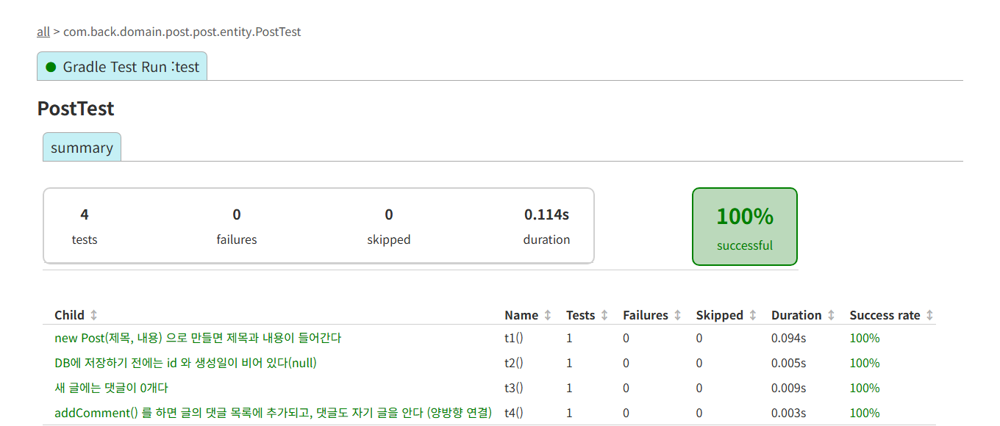

---

## 1-6: 샘플 댓글 5건 자동 생성 + 테스트

### 바뀐 것

| 구분 | 파일 | 내용 |
|---|---|---|
| 수정 | `BaseInitData.java` | 샘플 댓글 5건 추가, `work1()` 에 `@Transactional`, `self.work1()` 로 호출 |
| 수정 | `Post.java` | `@OneToMany(mappedBy = "post", cascade = PERSIST)` — `cascade` 추가 |
| 수정 | `BaseInitDataTest.java` | 댓글 테스트 2개 추가 (`t3`, `t4`) |

### 샘플 데이터 (1단계 최종)

| 글 | 댓글 |
|---|---|
| 1번 `제목 1` | `댓글 1-1`, `댓글 1-2`, `댓글 1-3` |
| 2번 `제목 2` | `댓글 2-1`, `댓글 2-2` |
| 3번 `제목 3` | (없음) |

### 핵심 포인트
- **`@Transactional`**: `work1()` 전체를 하나의 트랜잭션으로 묶는다. 트랜잭션이 끝날 때 JPA가 그 사이 바뀐 내용(새 댓글)을 모아서 DB에 반영한다.
- **`self.work1()`**: `@Transactional` 은 스프링이 만든 프록시를 거쳐 호출될 때만 동작한다. `this.work1()` 로 부르면 무시된다.
- **`cascade = PERSIST`**: 글이 저장될 때, 글의 `comments` 에 새로 들어간 댓글도 같이 저장한다. 그래서 댓글마다 `save()` 를 부르지 않아도 된다.

### Before: `cascade` 없이 실행 → 댓글이 하나도 저장되지 않음

`addComment()` 는 자바 객체끼리 연결만 할 뿐, JPA에게 "이 댓글도 저장해"라고 알려 주지 않는다. 에러도 나지 않고 조용히 저장이 안 된다. 테스트가 아니었으면 놓치기 쉬운 문제다.

```
BaseInitDataTest > 앱이 시작되면 샘플 댓글 5건이 DB에 저장되어 있다 FAILED
    expected: 5
     but was: 0
BaseInitDataTest > 1번 글에 댓글 3건, 2번 글에 댓글 2건, 3번 글에는 댓글이 없다 FAILED
12 tests completed, 2 failed

실행된 insert into post_comment 횟수: 0
```


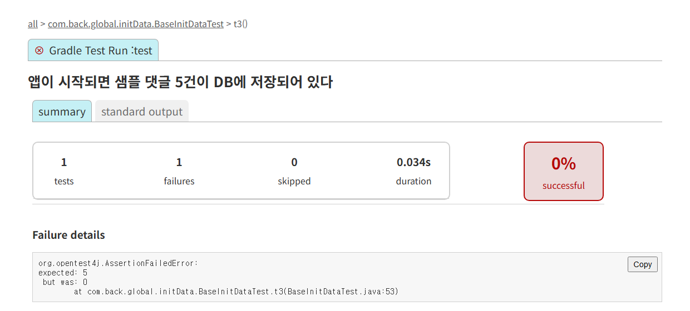

### After: `cascade = PERSIST` 추가 → 댓글 5건 저장

```java
@OneToMany(mappedBy = "post", cascade = PERSIST)
private List<PostComment> comments = new ArrayList<>();
```

```sql
-- 5번 실행됨 (댓글 1-1, 1-2, 1-3, 2-1, 2-2)
insert into post_comment (content, create_date, modify_date, post_id, id)
values (?, ?, ?, ?, default)
```


### 테스트 결과

| 테스트 | 검증 내용 | 결과 |
|---|---|---|
| `BaseInitDataTest.t3` | 앱이 시작되면 샘플 댓글 5건이 DB에 있다 | ✅ 통과 |
| `BaseInitDataTest.t4` | 1번 글 댓글 3건, 2번 글 2건, 3번 글 0건 (내용까지 확인) | ✅ 통과 |
| 전체 | 12건 | ✅ 통과 |


---

## 2-1: 글 작성 API

### 바뀐 것

| 구분 | 파일 | 내용 |
|---|---|---|
| 추가 | `domain/post/post/controller/ApiV1PostController.java` | `POST /api/v1/posts` 요청을 받아 글 작성 |
| 추가 | `domain/post/post/dto/PostDto.java` | 응답으로 내보낼 글 데이터(`id`, `createDate`, `modifyDate`, `title`, `content`) |

### 요청과 응답

```http
POST /api/v1/posts
Content-Type: application/json

{"title": "새 글 제목", "content": "새 글 내용"}
```

```http
HTTP/1.1 201
Content-Type: application/json

{"id":4,"createDate":"...","modifyDate":"...","title":"새 글 제목","content":"새 글 내용"}
```

### 핵심 포인트
- **흐름**: 요청 → `ApiV1PostController.write()` → `PostService.write()` (1-3) → `PostRepository.save()` → DB
- **`@RestController`**: 메서드가 돌려준 객체를 JSON 으로 바꿔서 응답한다.
- **`@RequestBody`**: 요청 본문의 JSON 을 `PostWriteReqBody` 객체로 바꿔 준다.
- **`@ResponseStatus(CREATED)`**: 성공 시 상태코드 `201`. "새로 만들어졌다"는 뜻.
- **`PostDto`**: 엔티티(`Post`)를 그대로 응답하지 않는다.
  - 엔티티에는 `comments` 가 있고 댓글에는 다시 `post` 가 있어서, 그대로 JSON 으로 바꾸면 끝없이 이어질 수 있다(순환참조).
  - 응답에 보여 줄 칸만 골라 담으면 엔티티가 바뀌어도 API 응답 모양은 그대로 유지된다.
- **`record`**: 필드, 생성자, 값 꺼내는 메서드(`title()` 등)를 자동으로 만들어 주는 간단한 클래스.

### 기록: 앱을 실행해서 직접 요청 (`./gradlew bootRun` + `curl`)

샘플 글 1, 2, 3 다음 번호인 **4번** 으로 저장되었다.

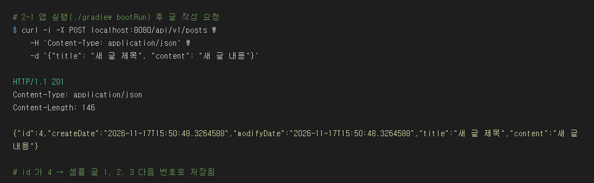

### 테스트 결과
- 이번 단계에는 새 테스트가 없다. API 테스트(MockMvc)는 **2-2** 에서 만든다.
- 기존 테스트 12건은 그대로 통과(`BUILD SUCCESSFUL`).

---

## 2-2: 글 작성 MockMvc 성공 테스트

### 바뀐 것

| 구분 | 파일 | 내용 |
|---|---|---|
| 추가 | `test/.../controller/ApiV1PostControllerTest.java` | 글 작성 API 테스트 |
| 수정 | `PostService.java` | `findById(id)` 추가 (테스트에서 DB에 저장된 글을 꺼내 보려고) |

### 핵심 포인트
- **MockMvc**: 실제 서버(8080)를 켜지 않고, 컨트롤러에 HTTP 요청을 보낸 것처럼 흉내 낸다. 2-1 에서 `bootRun` + `curl` 로 손으로 하던 확인을 자동화한 것.
- **`@AutoConfigureMockMvc`**: 테스트에서 `MockMvc` 를 주입받을 수 있게 준비해 준다.
- **테스트 구조**
  1. `mvc.perform(post(...))` 로 요청을 보낸다
  2. `postService.findById(4)` 로 DB에 저장된 글을 꺼낸다
  3. 응답 검사: 처리한 컨트롤러·메서드, 상태코드 `201`, 응답 JSON 의 **모든 필드**(`id`, `createDate`, `modifyDate`, `title`, `content`)
  4. DB 검사: 요청한 제목·내용 그대로 저장되었는지
- **`andDo(print())`**: 요청과 응답 내용을 로그로 출력한다. 테스트가 실패했을 때 원인을 찾기 좋다.
- **`Optional`**: `findById` 는 글이 없을 수도 있으므로 `Optional<Post>` 로 돌려준다. `.get()` 으로 꺼낸다.

### 기록: `andDo(print())` 출력

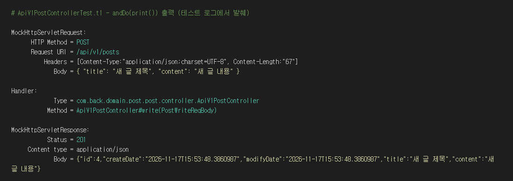

### 테스트 결과

| 테스트 | 검증 내용 | 결과 |
|---|---|---|
| `ApiV1PostControllerTest.t1` | `POST /api/v1/posts` → `write` 메서드가 처리, `201`, 응답 JSON 5개 필드, DB 저장 내용 | ✅ 통과 |
| 기존 테스트 12건 | | ✅ 통과 |

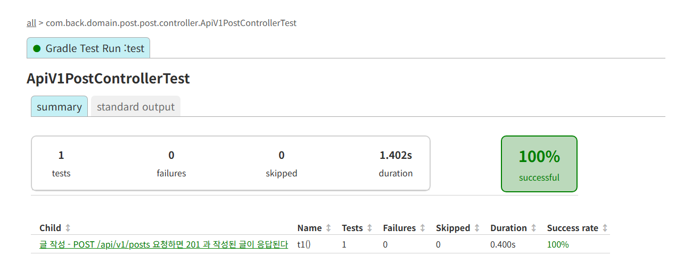

---

## 2-3: 글 작성 입력값 검증 + 실패 테스트

### 바뀐 것

| 구분 | 파일 | 내용 |
|---|---|---|
| 수정 | `build.gradle.kts` | `spring-boot-starter-validation` 추가 |
| 수정 | `ApiV1PostController.java` | `PostWriteReqBody` 에 `@NotBlank`, `@Size` / 파라미터에 `@Valid` |
| 수정 | `ApiV1PostControllerTest.java` | 실패 테스트 2개 추가 (`t2`, `t3`) |

### 검증 규칙

| 필드 | 규칙 |
|---|---|
| `title` | `@NotBlank` (null, `""`, 공백만 X) + `@Size(min = 2, max = 100)` |
| `content` | `@NotBlank` + `@Size(min = 2, max = 5000)` |

### 진행 순서: 테스트 먼저 → 실패 확인 → 기능 추가 → 통과

**Before: 실패 테스트를 먼저 작성하고 실행** — 검증이 없으니 빈 제목도 저장되어 `201` 이 나왔다.

```
ApiV1PostControllerTest > 글 작성 실패 - 제목이 비어 있으면 400 이고, 글이 저장되지 않는다 FAILED
    java.lang.AssertionError: Status expected:<400> but was:<201>
ApiV1PostControllerTest > 글 작성 실패 - 내용이 공백뿐이면 400 이고, 글이 저장되지 않는다 FAILED
15 tests completed, 2 failed
```

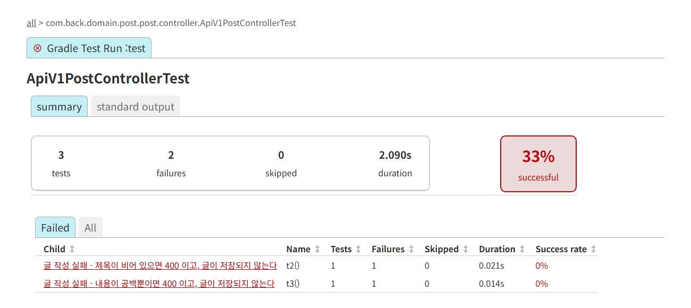
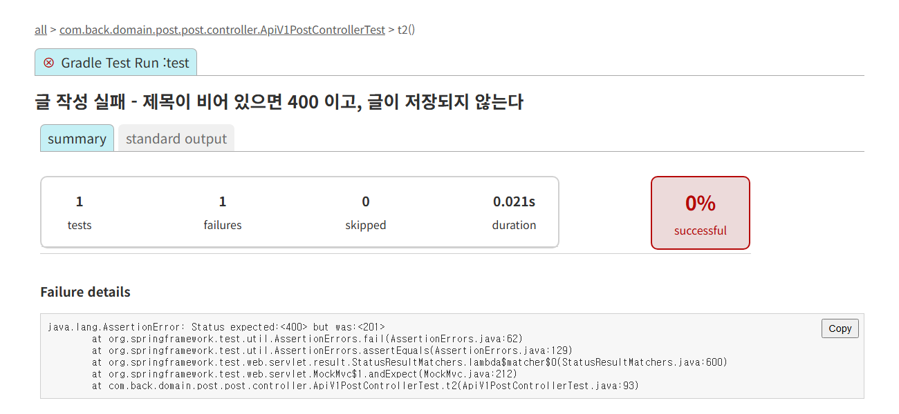

**After: `@Valid` + `@NotBlank`, `@Size` 추가** — 검증에 걸리면 `write()` 안의 코드가 실행되지 않고 `400` 이 응답된다.

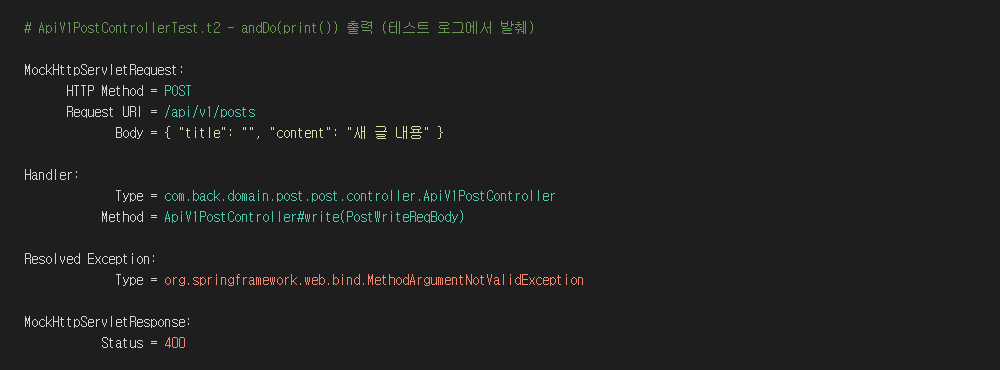

### 핵심 포인트
- **`@Valid`**: 이게 붙어야 `PostWriteReqBody` 의 검증 규칙을 실제로 검사한다. 빼면 규칙이 있어도 무시된다.
- 검증에 실패하면 스프링이 `MethodArgumentNotValidException` 을 던지고 **400 Bad Request** 로 응답한다. 컨트롤러 메서드 본문은 실행되지 않으므로 DB에 저장되지 않는다.
- 지금은 400 응답의 본문이 비어 있다. "무엇이 잘못됐는지" 알려 주는 에러 메시지는 아직 없다.

### 테스트 결과

| 테스트 | 검증 내용 | 결과 |
|---|---|---|
| `ApiV1PostControllerTest.t2` | 제목이 `""` → `400`, 글 개수 그대로 | ✅ 통과 |
| `ApiV1PostControllerTest.t3` | 내용이 `"   "` → `400`, 글 개수 그대로 | ✅ 통과 |
| 기존 테스트 13건 | | ✅ 통과 |

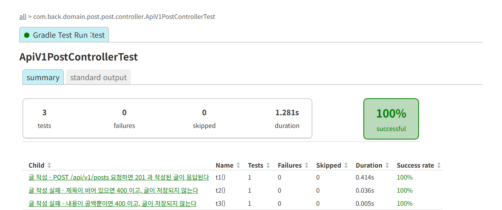

---

## 3-1: 글 삭제 API

### 바뀐 것

| 구분 | 파일 | 내용 |
|---|---|---|
| 수정 | `PostService.java` | `delete(post)` 추가 |
| 수정 | `ApiV1PostController.java` | `DELETE /api/v1/posts/{id}` → `delete(id)` 추가 |

### 요청과 응답

```http
DELETE /api/v1/posts/3
```

```http
HTTP/1.1 200
Content-Type: application/json

{"id":3,"createDate":"...","modifyDate":"...","title":"제목 3","content":"내용 3"}
```

### 핵심 포인트
- **`@DeleteMapping("/{id}")`**: 클래스의 `/api/v1/posts` + `/{id}` → `DELETE /api/v1/posts/3` 같은 요청을 받는다.
- **`@PathVariable`**: 주소의 `{id}` 자리에 있는 값(`3`)을 꺼내서 `id` 변수에 넣는다.
- **흐름**: `findById(id).get()` 으로 글을 찾고 → `postService.delete(post)` → 삭제된 글 정보를 응답(상태코드 기본값 `200`).
- 아직 확인하지 않은 경우가 2가지 있다.
  - 댓글이 달린 글(1번, 2번)을 지우면? → **3-2** 에서 테스트
  - 없는 글(예: 999번)을 지우면? → **3-3** 에서 테스트

### 기록: 앱을 실행해서 직접 요청 (`./gradlew bootRun` + `curl`)

댓글이 없는 **3번 글** 을 삭제했다. 서버 로그에 `delete from post where id=?` 가 실행되었다.

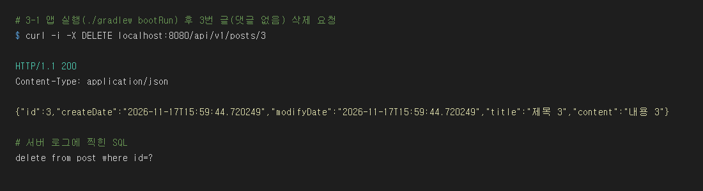

### 테스트 결과
- 이번 단계에는 새 테스트가 없다. 삭제 API 테스트는 **3-2** 에서 만든다.
- 기존 테스트 15건은 그대로 통과(`BUILD SUCCESSFUL`).

---

## 3-2: 글 삭제 성공 테스트 (댓글 있는 글) + `cascade = REMOVE`

### 바뀐 것

| 구분 | 파일 | 내용 |
|---|---|---|
| 수정 | `ApiV1PostControllerTest.java` | 댓글 3개가 달린 1번 글 삭제 테스트 `t4` 추가 |
| 수정 | `Post.java` | `comments` 의 `cascade = PERSIST` → `cascade = {PERSIST, REMOVE}` |

### 진행 순서: 테스트 먼저 → 실패 확인 → 기능 추가 → 통과

**Before: 테스트를 먼저 작성하고 실행** — `post_comment` 테이블에 1번 글을 가리키는 댓글 3개가 남아 있어서, DB가 글 삭제를 거부했다(외래키 제약 위반).

```
ApiV1PostControllerTest > 글 삭제 - 댓글이 달린 1번 글을 DELETE 하면 ... FAILED
    org.springframework.dao.DataIntegrityViolationException at ApiV1PostControllerTest.java:149
        Caused by: org.h2.jdbc.JdbcSQLIntegrityConstraintViolationException
Referential integrity constraint violation: "... POST_COMMENT FOREIGN KEY(POST_ID) REFERENCES PUBLIC.POST(ID) (1)"
SQL statement: delete from post where id=?
4 tests completed, 1 failed
```

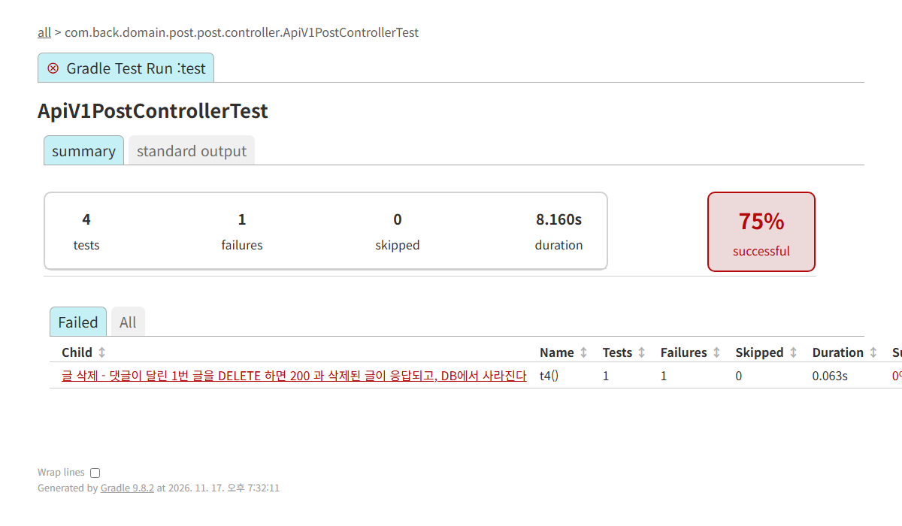
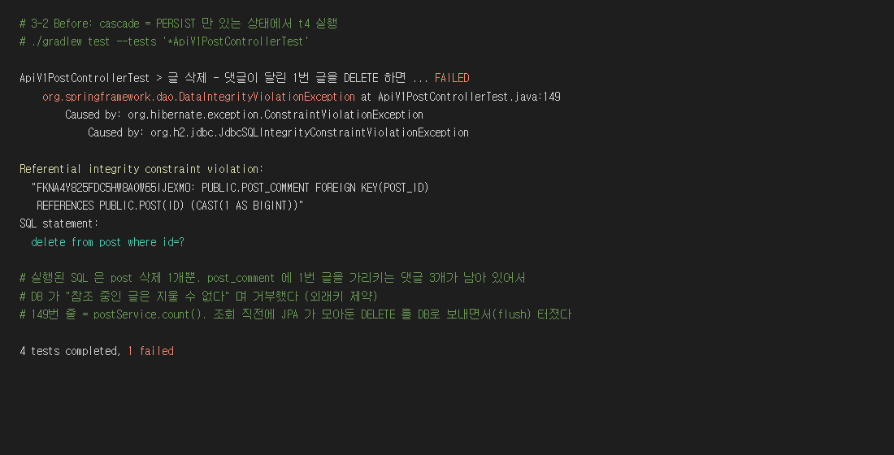

**After: `cascade` 에 `REMOVE` 추가** — 글을 지우기 전에 댓글 3개를 먼저 지우고, 마지막에 글을 지운다.

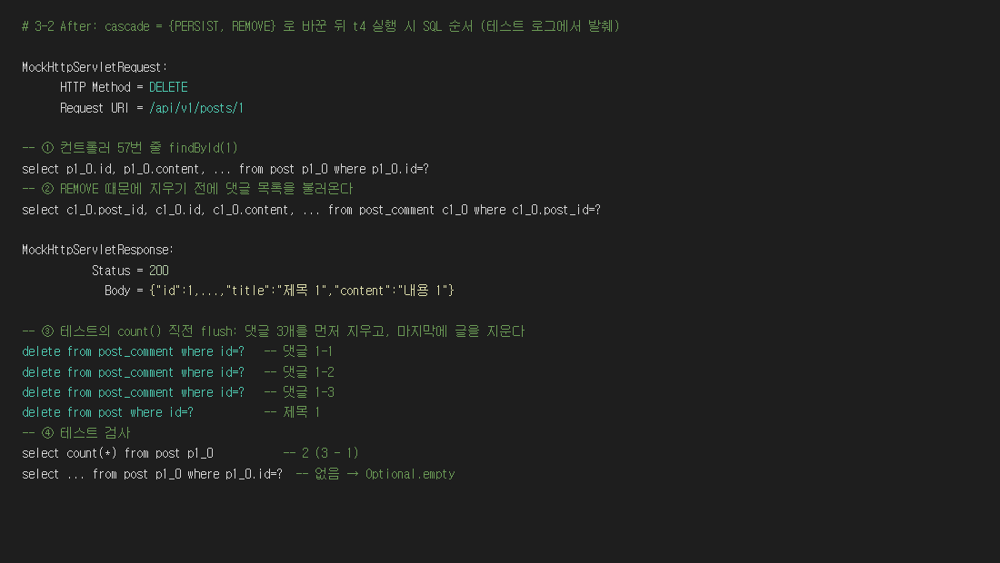

### 핵심 포인트
- **외래키 제약**: `post_comment.post_id` 가 `post.id` 를 가리키고 있으면, 그 글은 DB가 지우지 못하게 막는다. 고아 댓글이 생기는 것을 막기 위한 안전장치다.
- **`CascadeType.REMOVE`**: 글(부모)을 `delete` 하면 `comments`(자식)에도 `delete` 를 전파한다. JPA가 댓글 목록을 먼저 불러온 뒤 `delete from post_comment` → `delete from post` 순서로 실행한다.
- **에러가 149번 줄(`count()`)에서 난 이유**: 테스트 전체가 `@Transactional` 이라 `delete()` 가 테스트 트랜잭션에 합류했다. JPA는 DELETE 를 바로 보내지 않고 모아 두었다가, 다음 조회(`count()`) 직전에 DB로 보낸다(flush). 그 순간 DB가 거부한 것이다.
- **`findById(1)` → `isEmpty()`**: 글이 정말로 DB에서 사라졌는지 확인한다. `findById` 가 `Optional` 을 돌려주므로 비어 있으면 없는 글이다.

### 테스트 결과

| 테스트 | 검증 내용 | 결과 |
|---|---|---|
| `ApiV1PostControllerTest.t4` | `DELETE /api/v1/posts/1` → `200`, 응답 `id=1`·`제목 1`·`내용 1`, 글 개수 3 → 2, `findById(1)` 비어 있음 | ✅ 통과 |
| 기존 테스트 15건 | | ✅ 통과 |

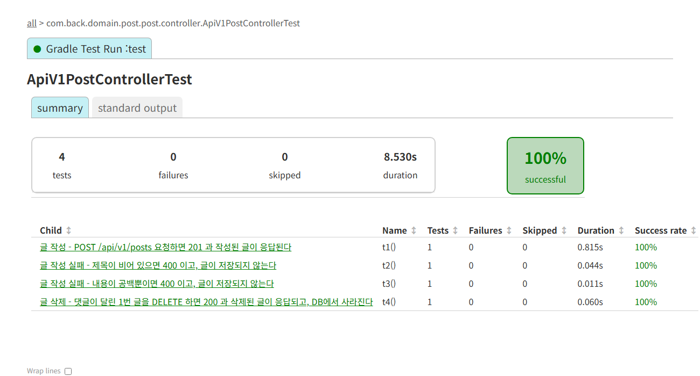
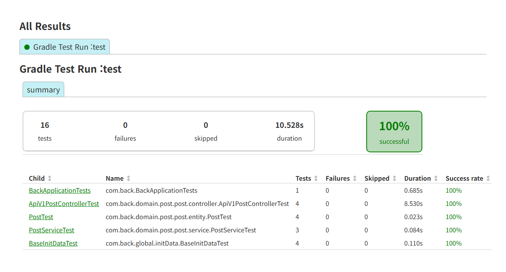

---

## 3-3: 없는 글 삭제 → 404 + 실패 테스트

### 바뀐 것

| 구분 | 파일 | 내용 |
|---|---|---|
| 수정 | `ApiV1PostControllerTest.java` | 없는 글(999번) 삭제 실패 테스트 `t5` 추가 |
| 수정 | `ApiV1PostController.java` | `findById(id).get()` → `findById(id).orElseThrow(() -> new ResponseStatusException(NOT_FOUND, ...))` |

### 요청과 응답

```http
DELETE /api/v1/posts/999
```

```http
HTTP/1.1 404
(Error message: 999번 글은 존재하지 않습니다.)
```

### 진행 순서: 테스트 먼저 → 실패 확인 → 기능 추가 → 통과

**Before: 테스트를 먼저 작성하고 실행** — 빈 `Optional` 에 `.get()` 을 해서 `NoSuchElementException` 이 터졌다. 아무도 처리하지 않는 예외라서 404 가 아니라 서버 에러(500)가 된다.

```
ApiV1PostControllerTest > 글 삭제 실패 - 없는 글(999번)을 DELETE 하면 404 이고, 글 개수는 그대로다 FAILED
    jakarta.servlet.ServletException at ApiV1PostControllerTest.java:161
        Caused by: java.util.NoSuchElementException: No value present
5 tests completed, 1 failed
```

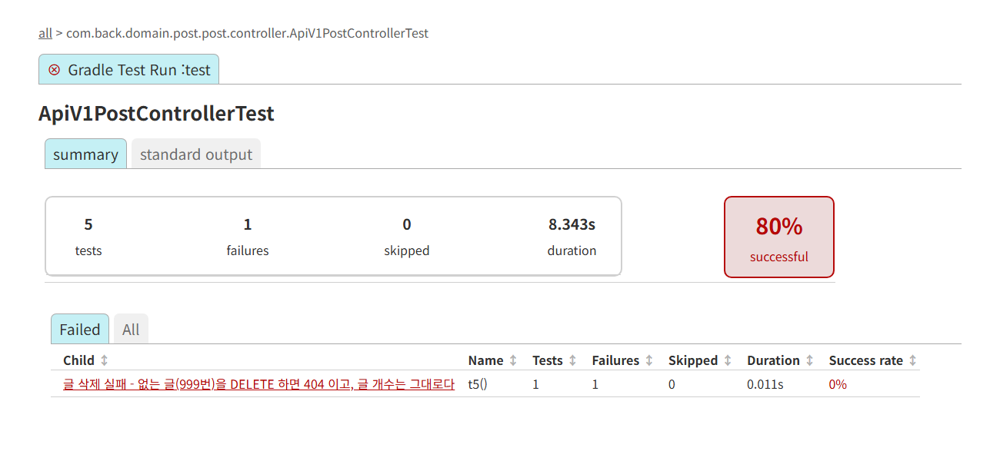
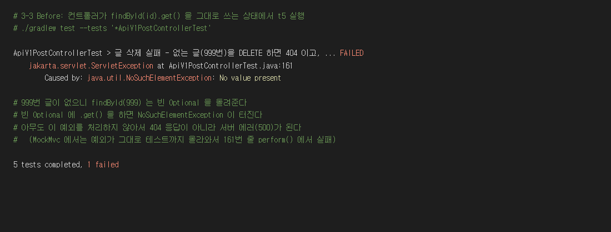

**After: `.orElseThrow(...)` 로 404 응답** — 글이 없으면 `ResponseStatusException(NOT_FOUND)` 을 던지고, 스프링이 이것을 `404` 응답으로 바꾼다. `delete` SQL 은 실행되지 않는다.

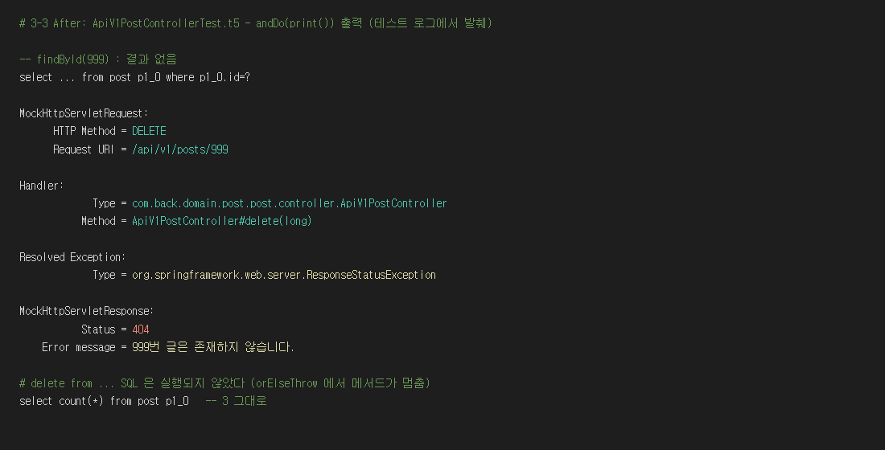

### 핵심 포인트
- **`Optional.get()`**: 값이 없으면 `NoSuchElementException` 을 던진다. "없을 수도 있다"는 경우를 무시하는 코드라서 위험하다.
- **`Optional.orElseThrow(() -> 예외)`**: 값이 있으면 꺼내고, 없으면 내가 고른 예외를 던진다.
- **`ResponseStatusException`**: 스프링이 알아보는 예외. 던질 때 정한 상태코드(`NOT_FOUND` = 404)와 메시지로 응답한다. 예외가 던져진 줄에서 메서드가 멈추므로 아래의 `delete()` 는 실행되지 않는다.
- **상태코드 의미**: `500` = 서버 잘못(버그), `404` = 요청한 대상이 없음(클라이언트가 확인할 문제). 없는 글 삭제는 404 가 맞다.
- 지금은 응답 본문이 비어 있다. 에러 내용을 JSON 으로 돌려주는 것은 이번 실습 범위 밖이다.

### 테스트 결과

| 테스트 | 검증 내용 | 결과 |
|---|---|---|
| `ApiV1PostControllerTest.t5` | `DELETE /api/v1/posts/999` → `404`, 글 개수 그대로 | ✅ 통과 |
| 기존 테스트 16건 | | ✅ 통과 |

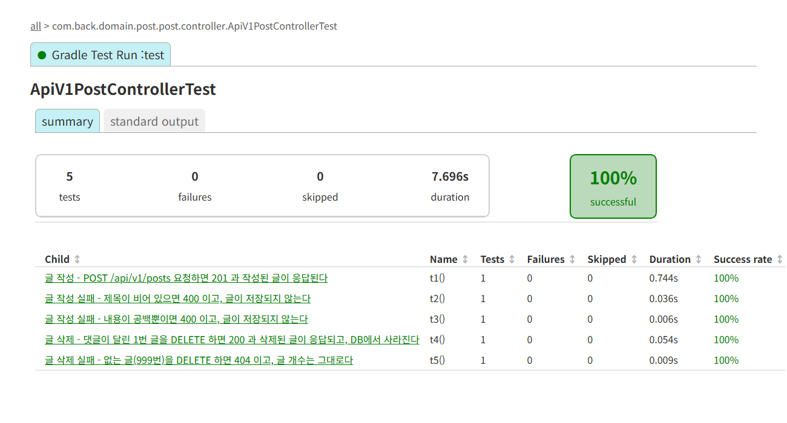


---

## 4-1: 댓글 작성 API

### 바뀐 것

| 구분 | 파일 | 내용 |
|---|---|---|
| 추가 | `postComment/dto/PostCommentDto.java` | 응답용 댓글 DTO (`id`, `createDate`, `modifyDate`, `postId`, `content`) |
| 추가 | `postComment/controller/ApiV1PostCommentController.java` | `POST /api/v1/posts/{postId}/comments` → `write(postId, reqBody)` |
| 수정 | `PostService.java` | `@Transactional writeComment(post, content)` 추가 (`addComment` + `flush`) |

### 요청과 응답

```http
POST /api/v1/posts/1/comments
Content-Type: application/json

{"content": "새 댓글"}
```

```http
HTTP/1.1 201
Content-Type: application/json

{"id":6,"createDate":"...","modifyDate":"...","postId":1,"content":"새 댓글"}
```

없는 글(`/api/v1/posts/999/comments`)에 달면 `404` (3-3 과 같은 `orElseThrow` 방식).

### 핵심 포인트
- **주소에 글 번호가 들어간다**: 댓글은 항상 어떤 글에 속하므로 `@RequestMapping("/api/v1/posts/{postId}/comments")`. `@PathVariable long postId` 로 꺼낸다.
- **댓글은 글을 통해서 만든다**: `post.addComment(content)` → 1-6 샘플 댓글과 같은 방식. 댓글용 리포지터리 없이 `cascade = PERSIST` 로 저장된다.
- **`@Transactional` 이 필요한 이유**: `addComment()` 는 `save()` 를 부르지 않는 "객체 수정"이다. 감싸는 트랜잭션이 있어야 JPA가 변화를 알아채서 INSERT 한다(1-6, 3-1 질문 참고).
- **`flush()` 가 필요한 이유**: INSERT 는 원래 트랜잭션이 끝날 때 실행된다. 그 전에 응답을 만들면 댓글 `id` 가 `null` 이다. `flush()` 로 지금 바로 INSERT 해서 `id` 를 받는다.
- **`PostCommentDto` 에는 글 전체가 아니라 `postId` 만**: 댓글 → 글 → 댓글 목록 → ... 순환참조를 막는다.
- 아직 빈 댓글(`""`)도 저장된다 → **4-3** 에서 검증 추가.

### 기록: 앱을 실행해서 직접 요청 (`./gradlew bootRun` + `curl`)

샘플 댓글 5개 다음이므로 새 댓글은 **6번**. SQL 은 `select post` → `insert into post_comment` 순서로 실행되었다.

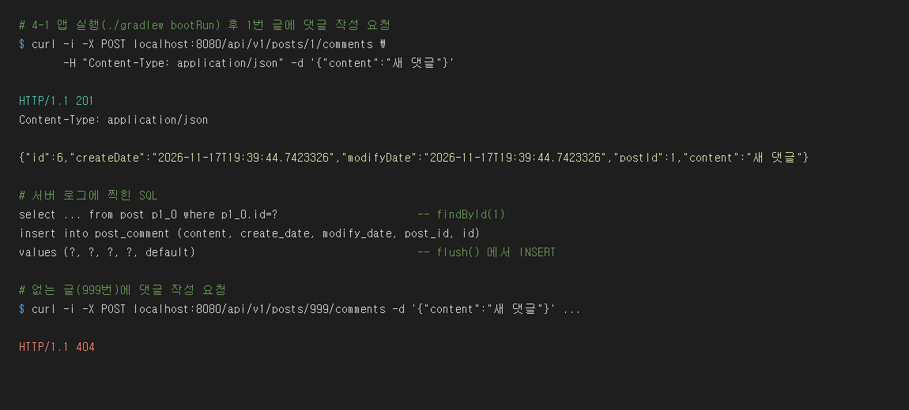

### 테스트 결과
- 이번 단계에는 새 테스트가 없다. 댓글 작성 MockMvc 테스트는 **4-2** 에서 만든다.
- 기존 테스트 17건은 그대로 통과(`BUILD SUCCESSFUL`).

---

## 4-2: 댓글 작성 MockMvc 성공 테스트

### 바뀐 것

| 구분 | 파일 | 내용 |
|---|---|---|
| 추가 | `test/.../postComment/controller/ApiV1PostCommentControllerTest.java` | 댓글 작성 성공 테스트 `t1` |

### 테스트 흐름 (2-2 글 작성 테스트와 같은 구성)
1. **요청**: `POST /api/v1/posts/1/comments` + `{"content": "새 댓글"}` (4-1 의 curl 과 같은 요청)
2. **DB에서 꺼내기**: `postService.findById(1).get().getComments().getLast()` → 방금 작성한 댓글
3. **응답 검사**: 처리한 컨트롤러·메서드, `201`, JSON 의 `id`, `createDate`, `modifyDate`, `postId`, `content`
4. **DB 검사**: 1번 글의 댓글 3개 → 4개, 새 댓글 `id` 는 6, 내용 `새 댓글`, 연결된 글이 1번 글

### 핵심 포인트
- **댓글 리포지터리 없이 댓글을 꺼내는 방법**: 글을 찾은 뒤 `post.getComments()`. 댓글은 글을 통해 만들고, 글을 통해 꺼낸다.
- **`getLast()`**: 리스트의 마지막 요소 (Java 21+). 방금 추가한 댓글이 목록의 맨 뒤에 있다.
- **`isSameAs(post)`**: 값이 같은지가 아니라 **같은 객체인지** 확인한다. 한 트랜잭션 안에서는 같은 글을 몇 번 꺼내도 JPA가 같은 객체를 돌려준다.
- **SQL 순서**: `select post` → `insert post_comment`(`flush`) → 응답 → `select post_comment`. 마지막 조회는 `comments` 가 `LAZY` 라서 테스트가 `getComments()` 를 실제로 쓸 때 실행된다.

### 기록: `andDo(print())` 출력 + SQL

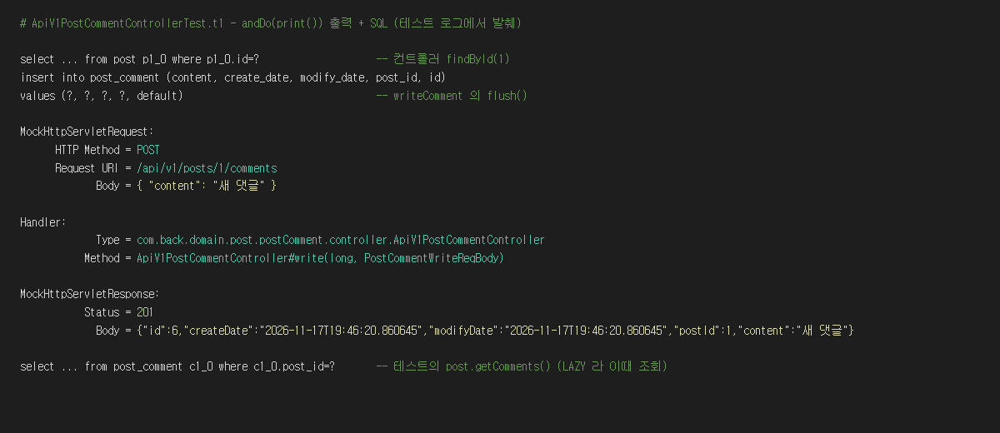

### 테스트 결과

| 테스트 | 검증 내용 | 결과 |
|---|---|---|
| `ApiV1PostCommentControllerTest.t1` | `POST /api/v1/posts/1/comments` → `201`, 응답 필드 5개, 댓글 3 → 4개, `id=6` | ✅ 통과 |
| 기존 테스트 17건 | | ✅ 통과 |

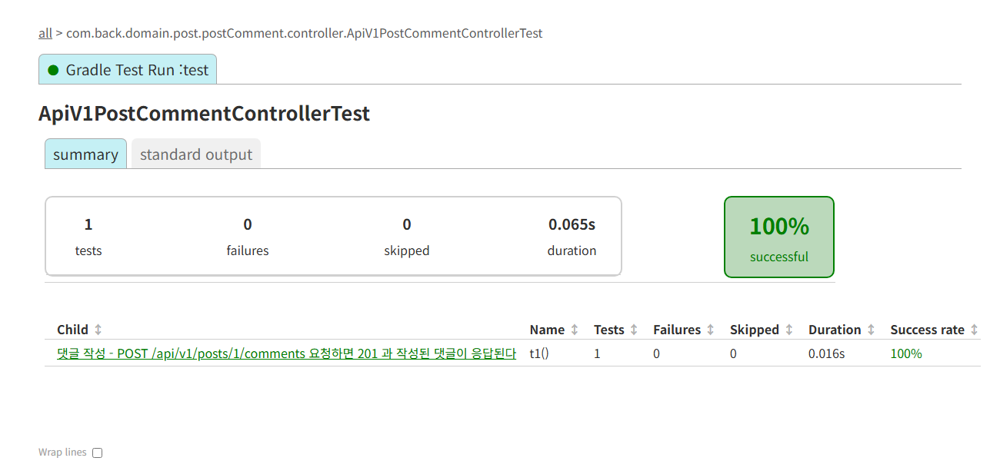
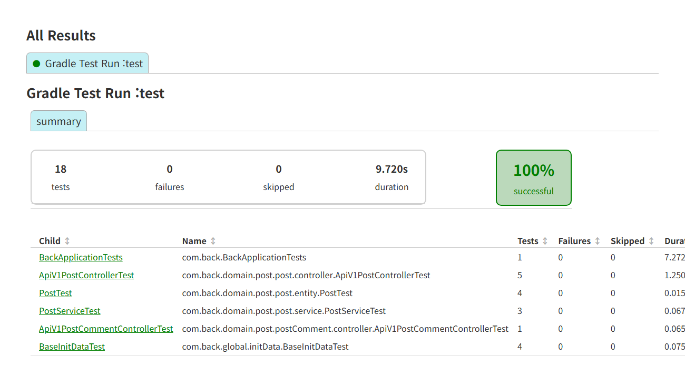

---

## 4-3: 댓글 작성 입력값 검증 + 실패 테스트

### 바뀐 것

| 구분 | 파일 | 내용 |
|---|---|---|
| 수정 | `ApiV1PostCommentControllerTest.java` | 실패 테스트 2개 추가 (`t2` 빈 내용 → 400, `t3` 없는 글 → 404) |
| 수정 | `ApiV1PostCommentController.java` | `PostCommentWriteReqBody.content` 에 `@NotBlank`, `@Size(min = 2, max = 1000)` / 파라미터에 `@Valid` |

### 진행 순서: 테스트 먼저 → 실패 확인 → 기능 추가 → 통과

**Before: 실패 테스트를 먼저 작성하고 실행** — 검증이 없으니 빈 댓글도 저장되어 `201` 이 나왔다. `t3`(404)는 4-1 에서 이미 `orElseThrow` 를 만들어 두어서 처음부터 통과.

```
ApiV1PostCommentControllerTest > 댓글 작성 실패 - 내용이 비어 있으면 400 이고, 댓글이 저장되지 않는다 FAILED
    java.lang.AssertionError: Status expected:<400> but was:<201>
3 tests completed, 1 failed
```

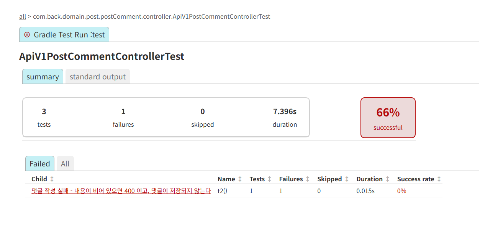
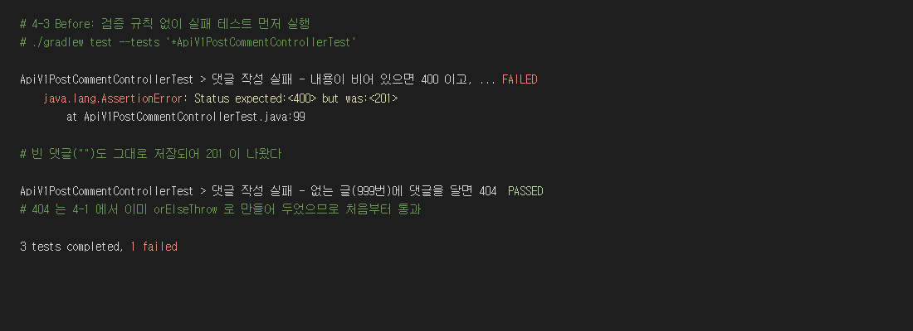

**After: `@Valid` + `@NotBlank`, `@Size` 추가** — 검증에 걸리면 `write()` 가 실행되지 않고 `400` 이 응답된다.

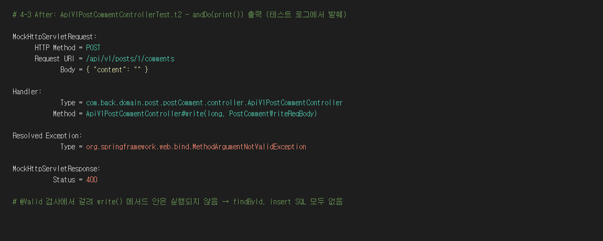

### 핵심 포인트
- 2-3 글 작성 검증과 **완전히 같은 방식**이다. 요청 상자(record)의 필드에 규칙을 달고, 컨트롤러 파라미터에 `@Valid` 를 붙인다.
- **검사 순서**: `@Valid` 검사(400)가 메서드 실행보다 먼저다. 그래서 내용이 빈 채로 없는 글에 요청하면 404 가 아니라 400 이 나온다.
- **`t2` 의 개수 검사**: 요청 전에 `post.getComments().size()` 를 저장하고, 요청 후 같은 목록의 크기가 그대로인지 확인한다. (한 트랜잭션 안이라 같은 `post` 객체를 계속 본다.)

### 테스트 결과

| 테스트 | 검증 내용 | 결과 |
|---|---|---|
| `ApiV1PostCommentControllerTest.t2` | 내용 `""` → `400`, 댓글 개수 그대로 | ✅ 통과 |
| `ApiV1PostCommentControllerTest.t3` | 없는 글(999) → `404` | ✅ 통과 |
| 기존 테스트 18건 | | ✅ 통과 |

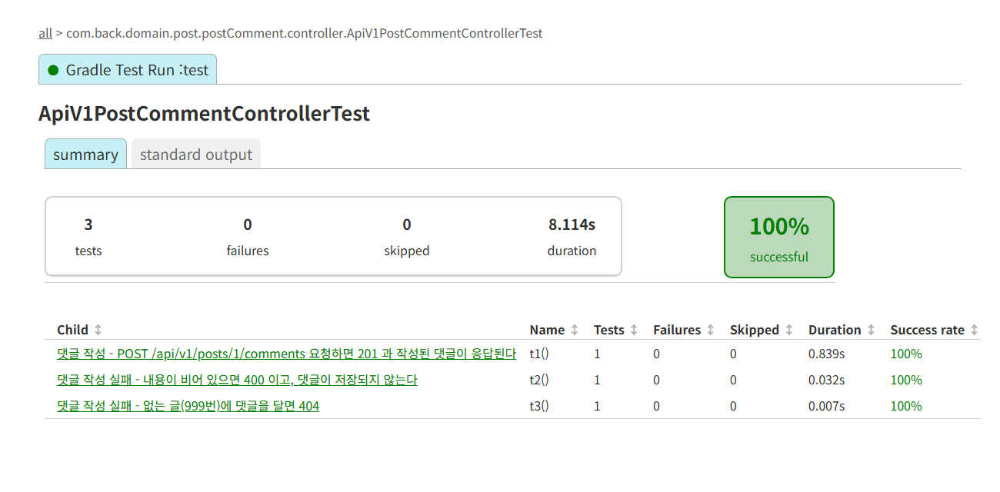


---

## 5-1: 댓글 삭제 API

### 바뀐 것

| 구분 | 파일 | 내용 |
|---|---|---|
| 수정 | `Post.java` | `comments` 에 `orphanRemoval = true` / `findCommentById(id)`, `deleteComment(comment)` 추가 |
| 수정 | `PostService.java` | `@Transactional deleteComment(post, comment)` 추가 |
| 수정 | `ApiV1PostCommentController.java` | `DELETE /api/v1/posts/{postId}/comments/{id}` → `delete(postId, id)` 추가 |

### 요청과 응답

```http
DELETE /api/v1/posts/1/comments/2
```

```http
HTTP/1.1 200
Content-Type: application/json

{"id":2,"createDate":"...","modifyDate":"...","postId":1,"content":"댓글 1-2"}
```

| 요청 | 결과 |
|---|---|
| 없는 글 `/posts/999/comments/1` | `404` (글 없음) |
| 없는 댓글 `/posts/1/comments/999` | `404` (댓글 없음) |
| 다른 글의 댓글 `/posts/2/comments/1` | `404` (2번 글의 댓글 목록에 1번 댓글이 없음) |

### 핵심 포인트
- **`@PathVariable` 2개**: 주소에 `{postId}` 와 `{id}` 가 모두 있다. 변수 이름이 같은 자리의 값을 받는다.
- **댓글은 글을 통해서 찾는다**: `post.findCommentById(id)` 는 **그 글의 댓글 목록 안에서만** 찾는다. 그래서 2번 글 주소로 1번 글의 댓글을 지울 수 없다.
- **댓글은 글을 통해서 지운다**: `post.deleteComment(comment)` 는 `comments.remove(comment)` 만 한다.
- **`orphanRemoval = true`**: 글의 목록에서 빠진 댓글(고아)을 DB에서도 삭제한다. 트랜잭션이 끝날 때 `delete from post_comment where id=?` 가 실행된다.
- **`cascade = REMOVE` 와의 차이**: `REMOVE` 는 "글을 지우면 댓글도", `orphanRemoval` 은 "글은 그대로, 목록에서 뺀 댓글만".
- **`@Transactional` 이 필요한 이유**: `remove()` 는 `delete()` 를 부르지 않는 "객체 수정"이다(4-1 `writeComment` 와 같은 이유).

### 기록: 앱을 실행해서 직접 요청 (`./gradlew bootRun` + `curl`)

1번 글의 **2번 댓글(댓글 1-2)** 을 삭제했다. 같은 요청을 다시 보내거나, 다른 글 주소로 보내면 `404`.

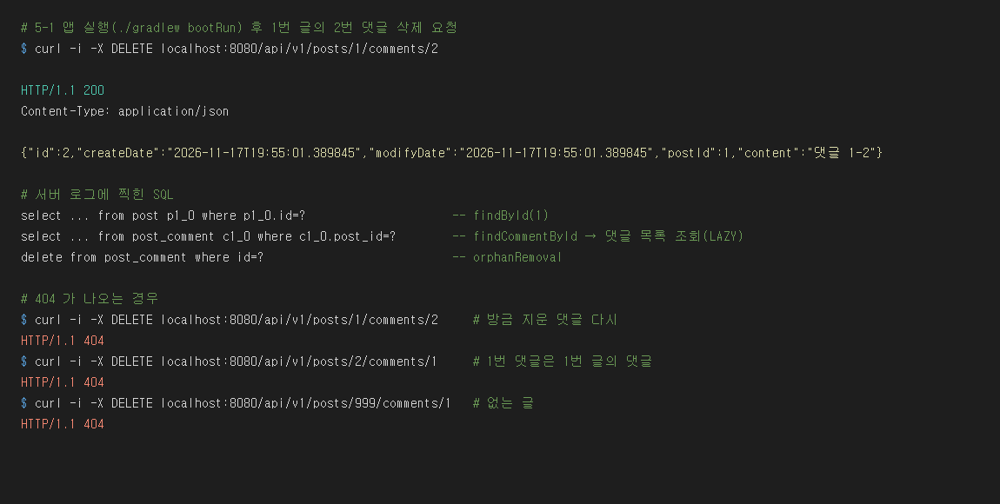

### 테스트 결과
- 이번 단계에는 새 테스트가 없다. 댓글 삭제 MockMvc 테스트는 **5-2** 에서 만든다.
- 기존 테스트 20건은 그대로 통과(`BUILD SUCCESSFUL`).

---

## 5-2: 댓글 삭제 MockMvc 성공 테스트

### 바뀐 것

| 구분 | 파일 | 내용 |
|---|---|---|
| 수정 | `ApiV1PostCommentControllerTest.java` | `EntityManager em` 주입, 댓글 삭제 성공 테스트 `t4` 추가 |

### 테스트 흐름
1. **요청**: `DELETE /api/v1/posts/1/comments/2` (5-1 의 curl 과 같은 요청)
2. **응답 검사**: 처리한 컨트롤러·메서드(`delete`), `200`, JSON 의 `id=2`, `postId=1`, `content=댓글 1-2`
3. **`em.flush()` + `em.clear()`**: 모아 둔 DELETE 를 DB로 보내고, JPA 가 기억하던 객체를 비운다
4. **DB 검사**: 1번 글을 다시 조회 → 댓글 2개(`댓글 1-1`, `댓글 1-3`), `findCommentById(2)` 비어 있음

### 핵심 포인트
- **왜 `flush` 가 필요한가**: 테스트 전체가 `@Transactional` 이라 서비스의 트랜잭션이 테스트 트랜잭션에 합류한다. `orphanRemoval` 의 DELETE 는 트랜잭션이 끝날 때 실행되는데, 테스트는 롤백으로 끝나므로 **그냥 두면 DELETE 가 DB까지 가지 않는다.** `flush()` 로 지금 보낸다.
- **왜 `clear` 가 필요한가**: JPA 는 한 번 꺼낸 객체를 기억해 두었다가(1차 캐시) 같은 것을 다시 찾으면 메모리의 객체를 돌려준다. 그러면 "목록에서 뺐다"는 것만 확인할 뿐, DB에서 지워졌는지는 모른다. `clear()` 후 다시 조회하면 **진짜 DB에서** 읽어 온다(로그에 `select` 가 다시 찍힘).
- **`extracting(PostComment::getContent).containsExactly(...)`**: 댓글 목록에서 내용만 뽑아 순서까지 정확히 같은지 확인한다.

### 기록: `andDo(print())` 출력 + SQL

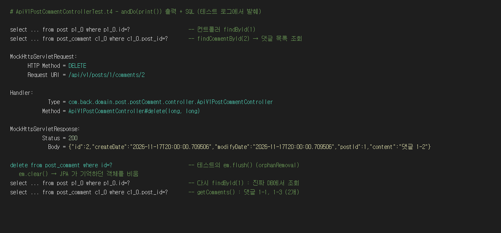

### 테스트 결과

| 테스트 | 검증 내용 | 결과 |
|---|---|---|
| `ApiV1PostCommentControllerTest.t4` | `DELETE /api/v1/posts/1/comments/2` → `200`, 응답 필드, DB 재조회 시 댓글 3 → 2개 | ✅ 통과 |
| 기존 테스트 20건 | | ✅ 통과 |

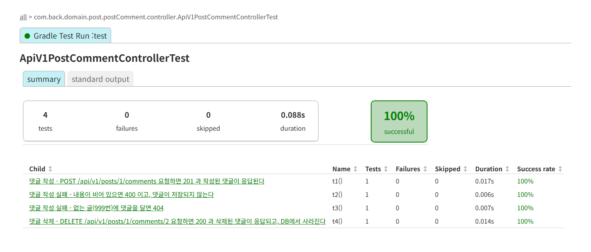
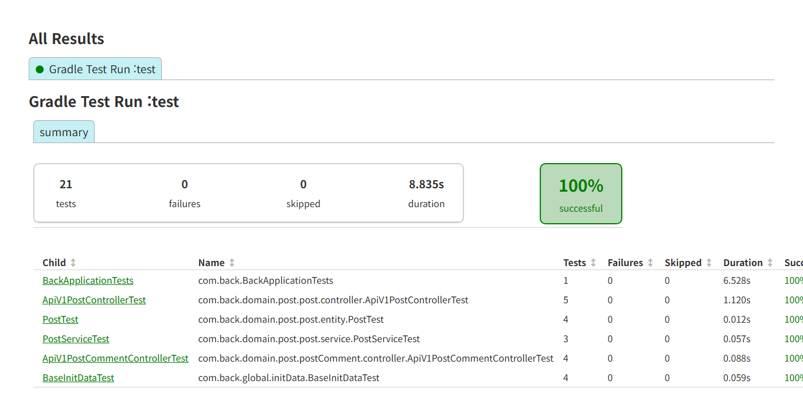
