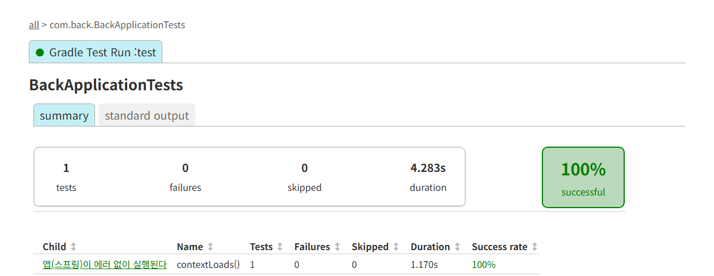
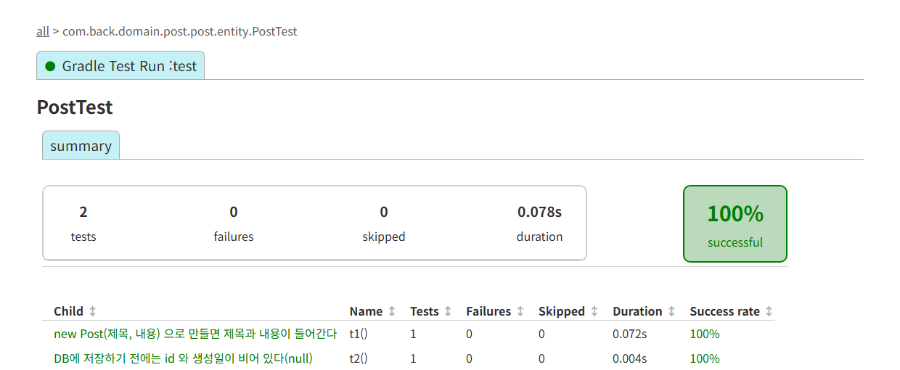
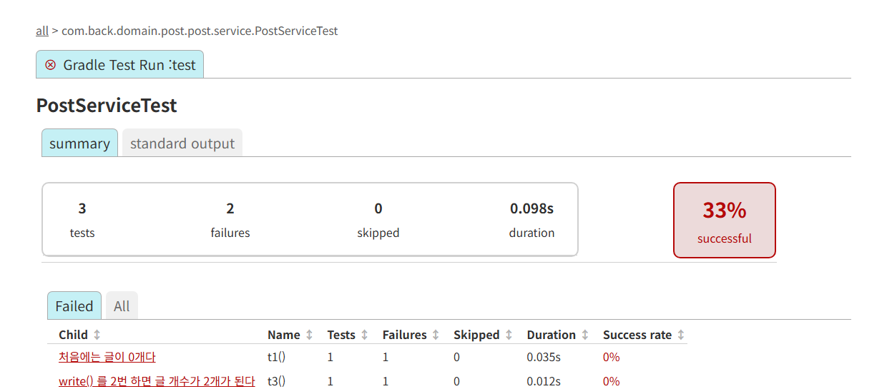
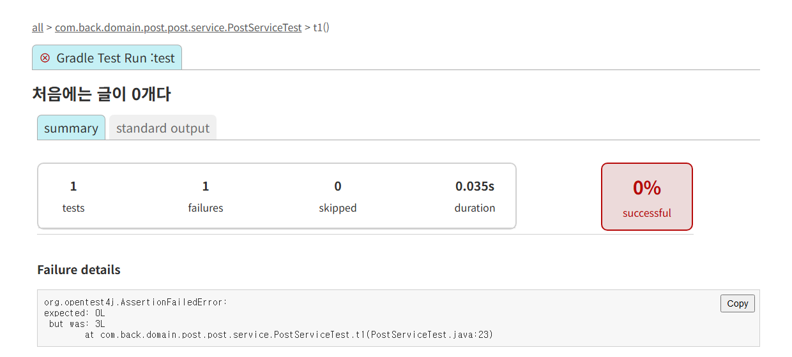
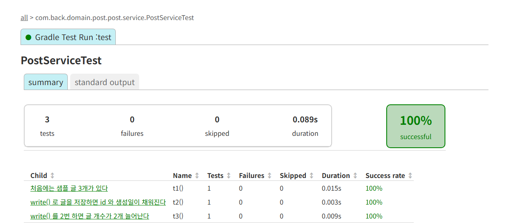
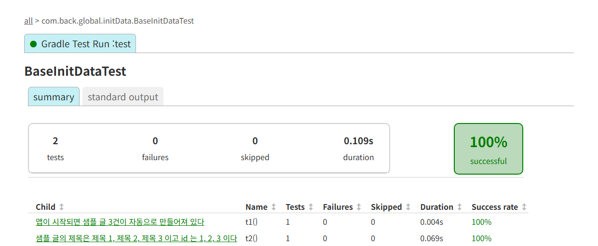
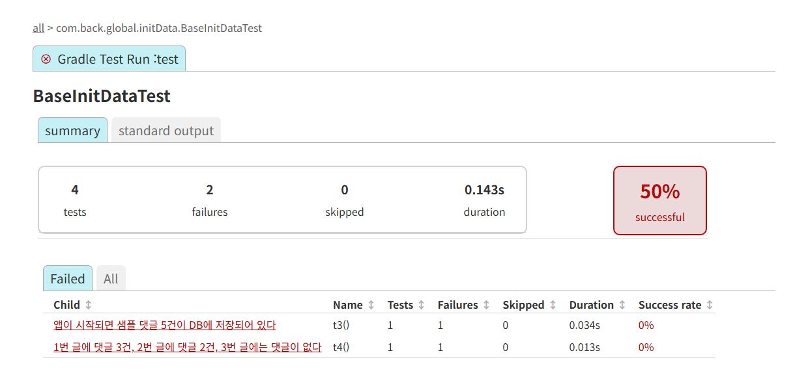
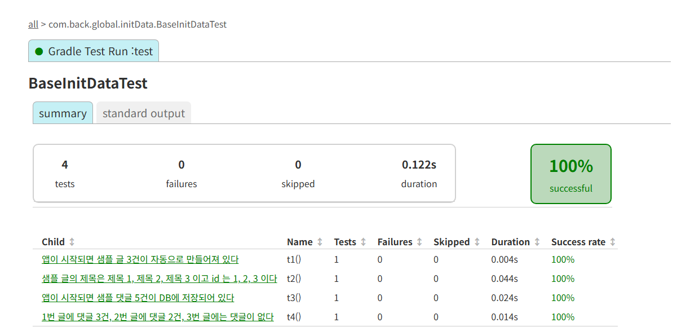
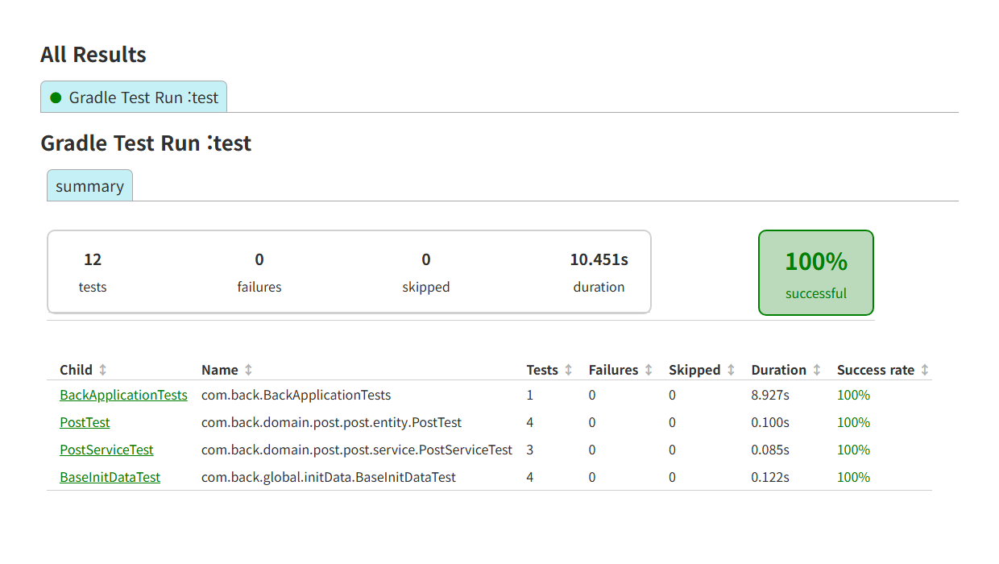

# POSTpractice2

글·댓글 게시판 REST API를 **아주 작은 단계**로 나눠 만들면서, 단계마다 코드 + 테스트 + 결과 캡처를 커밋하는 실습입니다.

- 참고: [slog.gg/p/14172](https://www.slog.gg/p/14172/raw)
- 기술: Java 25, Spring Boot 4.1.2, Spring Data JPA, H2, Lombok, JUnit 5 + MockMvc
- 테스트 실행: `./gradlew test` (리포트: `build/reports/tests/test/index.html`)

## 진행 상황

| 단계 | 내용 | 상태 |
|---|---|---|
| 1-1 | 빈 Spring Boot 프로젝트 + 앱 실행 테스트 | ✅ 완료 |
| 1-2 | JPA·H2 설정 + `BaseEntity` + `Post` 엔티티 | ✅ 완료 |
| 1-3 | `PostRepository` + `PostService` + 테스트 | ✅ 완료 |
| 1-4 | 샘플 글 3건 자동 생성 + 테스트 | ✅ 완료 |
| 1-5 | `PostComment` 엔티티 + `post.addComment()` | ✅ 완료 |
| 1-6 | 샘플 댓글 5건 자동 생성 + 테스트 | ✅ 완료 |
| 2-1 ~ 2-3 | 글 작성 API → 성공 테스트 → 입력값 검증·실패 테스트 | ⏳ 예정 |
| 3-1 ~ 3-3 | 글 삭제 API → 성공 테스트 → 없는 글 삭제·실패 테스트 | ⏳ 예정 |
| 4-1 ~ 4-3 | 댓글 작성 API → 성공 테스트 → 입력값 검증·실패 테스트 | ⏳ 예정 |
| 5-1 ~ 5-3 | 댓글 삭제 API → 성공 테스트 → 없는 댓글 삭제·실패 테스트 | ⏳ 예정 |

## 만들 API

| 메서드 | URL | 기능 | 단계 |
|---|---|---|---|
| POST | `/api/v1/posts` | 글 작성 | 2단계 |
| DELETE | `/api/v1/posts/{id}` | 글 삭제 | 3단계 |
| POST | `/api/v1/posts/{postId}/comments` | 댓글 작성 | 4단계 |
| DELETE | `/api/v1/posts/{postId}/comments/{id}` | 댓글 삭제 | 5단계 |

---

## 1-1: 빈 Spring Boot 프로젝트 + 앱 실행 테스트

### 추가된 파일

| 파일 | 역할 |
|---|---|
| `build.gradle.kts` | 사용할 라이브러리 목록. 지금은 웹(`webmvc`), Lombok, DevTools, 테스트용 라이브러리만 |
| `settings.gradle.kts` | 프로젝트 이름 `POSTpractice2` |
| `gradlew`, `gradle/wrapper/` | Gradle을 따로 설치하지 않아도 빌드할 수 있게 해 주는 래퍼 |
| `src/main/resources/application.yaml` | 앱 설정. 지금은 앱 이름만 |
| `src/main/java/com/back/BackApplication.java` | 앱의 시작점(`main` 메서드) |
| `src/test/java/com/back/BackApplicationTests.java` | 앱이 에러 없이 뜨는지 확인하는 테스트 |

### 핵심 포인트
- `@SpringBootApplication` 이 붙은 클래스의 패키지(`com.back`) **아래에** 있는 클래스만 스프링이 찾아낸다. 그래서 앞으로 만들 모든 클래스는 `com.back.…` 안에 둔다.
- `@SpringBootTest` 는 테스트할 때 스프링을 실제 실행처럼 통째로 띄운다. 테스트 메서드가 비어 있어도, 띄우는 도중에 에러가 나면 실패한다.

### 테스트 결과

| 테스트 | 검증 내용 | 결과 |
|---|---|---|
| `contextLoads` | 앱(스프링)이 에러 없이 실행된다 | ✅ 통과 |



---

## 1-2: JPA·H2 설정 + `BaseEntity` + `Post` 엔티티

### 바뀐 것

| 구분 | 파일 | 내용 |
|---|---|---|
| 수정 | `build.gradle.kts` | `data-jpa`, `h2console`, `h2` 라이브러리 3줄 추가 |
| 수정 | `application.yaml` | DB 연결(`./db_dev` 파일), SQL 로그 출력, 테이블 자동 생성 설정 |
| 수정 | `BackApplication.java` | `@EnableJpaAuditing` 1줄 추가 (날짜 자동 입력 켜기) |
| 추가 | `global/jpa/entity/BaseEntity.java` | 모든 엔티티 공통 칸: `id`, `createDate`, `modifyDate` |
| 추가 | `domain/post/post/entity/Post.java` | 글 엔티티: `title`, `content` |
| 추가 | `test/.../entity/PostTest.java` | `Post` 객체 생성 테스트 |

### 핵심 포인트
- **엔티티 = DB 테이블.** `@Entity` 가 붙은 `Post` 클래스를 보고, 앱이 켜질 때 JPA가 `post` 테이블을 자동으로 만든다(`ddl-auto: update`).
- **`BaseEntity` 를 상속**하므로 `Post` 에 직접 쓰지 않은 `id`, `create_date`, `modify_date` 칼럼도 생긴다.
- **`id` 는 DB가 정한다.** `new Post(...)` 로 만든 직후에는 `id` 가 `null` 이고, DB에 저장(INSERT)될 때 1, 2, 3 ... 이 매겨진다.

### 기록: 앱이 켜질 때 실행된 SQL (테스트 로그에서 발췌)

```sql
create table post (
    id bigint generated by default as identity,
    create_date timestamp(6),
    modify_date timestamp(6),
    content TEXT,
    title varchar(255),
    primary key (id)
)
```

### 테스트 결과

| 테스트 | 검증 내용 | 결과 |
|---|---|---|
| `BackApplicationTests.contextLoads` | JPA·H2 를 붙인 뒤에도 앱이 에러 없이 실행된다 | ✅ 통과 |
| `PostTest.t1` | `new Post("제목", "내용")` 으로 만들면 제목과 내용이 들어간다 | ✅ 통과 |
| `PostTest.t2` | DB에 저장하기 전에는 `id`, `createDate` 가 `null` 이다 | ✅ 통과 |



---

## 1-3: `PostRepository` + `PostService` + 테스트

### 바뀐 것

| 구분 | 파일 | 내용 |
|---|---|---|
| 추가 | `domain/post/post/repository/PostRepository.java` | DB 접근 담당. `JpaRepository` 상속만으로 `save`, `count` 등 사용 |
| 추가 | `domain/post/post/service/PostService.java` | `write(제목, 내용)`, `count()` |
| 추가 | `test/resources/application-test.yaml` | 테스트 전용 설정: 메모리 DB(`db_test`), `create-drop` |
| 수정 | `BackApplicationTests.java` | `@ActiveProfiles("test")` 1줄 추가 |
| 추가 | `test/.../service/PostServiceTest.java` | 글 저장·개수 테스트 |

### 핵심 포인트
- **역할 분리**: Controller(2단계) → **Service**(기능 단위 로직) → **Repository**(DB 접근)
- **의존성 주입**: `PostService` 는 `PostRepository` 를 직접 `new` 하지 않는다. `@RequiredArgsConstructor` 가 만든 생성자로 스프링이 넣어 준다.
- **테스트 DB 분리**: `@ActiveProfiles("test")` 가 붙은 테스트는 메모리 DB를 쓴다. 개발용 `db_dev` 파일은 그대로다.
- **`@Transactional` 테스트**: 테스트가 끝나면 저장한 글이 롤백된다. 그래서 `t3` 에서 2개를 저장해도 다른 테스트의 `count()` 에 영향이 없다.

### 기록: `write()`, `count()` 가 실행한 SQL (테스트 로그에서 발췌)

```sql
-- postService.write("제목", "내용") → postRepository.save(post)
insert into post (content, create_date, modify_date, title, id)
values (?, ?, ?, ?, default)

-- postService.count() → postRepository.count()
select count(*) from post p1_0
```

### 테스트 결과

| 테스트 | 검증 내용 | 결과 |
|---|---|---|
| `PostServiceTest.t1` | 처음에는 글이 0개다 | ✅ 통과 |
| `PostServiceTest.t2` | `write()` 로 저장하면 `id`, `createDate` 가 채워진다 (1-2 의 `PostTest.t2` 와 비교) | ✅ 통과 |
| `PostServiceTest.t3` | `write()` 를 2번 하면 `count()` 가 2 | ✅ 통과 |
| 기존 테스트 3건 | `contextLoads`, `PostTest.t1`, `PostTest.t2` | ✅ 통과 |


---

## 1-4: 샘플 글 3건 자동 생성 + 테스트

### 바뀐 것

| 구분 | 파일 | 내용 |
|---|---|---|
| 추가 | `global/initData/BaseInitData.java` | 앱 시작 시 글이 0개면 `제목 1`, `제목 2`, `제목 3` 생성 |
| 수정 | `PostService.java` | `findAll()` 추가 (전체 글 목록) |
| 추가 | `test/.../initData/BaseInitDataTest.java` | 샘플 글 3건 확인 테스트 |
| 수정 | `PostServiceTest.java` | 샘플 글 때문에 깨진 테스트 2개 수정 |

### 핵심 포인트
- **`ApplicationRunner`**: 앱 시작이 끝나면 자동으로 1번 실행된다. 여기서 샘플 글을 만든다.
- **`if (count() > 0) return;`**: 이미 글이 있으면 만들지 않는다. 그래서 앱을 여러 번 재시작해도 샘플 글이 계속 쌓이지 않는다.
- **테스트도 영향을 받는다**: 테스트도 스프링을 띄우므로 `BaseInitData` 가 실행된다. 즉 모든 테스트는 "글 3개가 있는 상태"에서 시작한다.

### Before: 샘플 글을 추가했더니 기존 테스트 2개가 실패

1-3 에서 만든 `PostServiceTest` 는 "처음에는 글이 0개"라고 가정했다. 샘플 글 3건이 생기면서 이 가정이 깨졌다.

```
PostServiceTest > 처음에는 글이 0개다 FAILED
    expected: 0L
     but was: 3L
PostServiceTest > write() 를 2번 하면 글 개수가 2개가 된다 FAILED
8 tests completed, 2 failed
```




### After: 테스트 수정

| 테스트 | Before | After |
|---|---|---|
| `t1` | `count()` 가 `0` | `count()` 가 `3` |
| `t3` | `count()` 가 `2` | 저장 전 개수(`before`)를 먼저 재고, `before + 2` 인지 확인 → 샘플 데이터 개수가 바뀌어도 깨지지 않음 |



### 테스트 결과

| 테스트 | 검증 내용 | 결과 |
|---|---|---|
| `BaseInitDataTest.t1` | 앱이 시작되면 샘플 글 3건이 있다 | ✅ 통과 |
| `BaseInitDataTest.t2` | 제목이 `제목 1`, `제목 2`, `제목 3` 이고 id 가 1, 2, 3 이다 | ✅ 통과 |
| 기존 테스트 6건 | `PostServiceTest` 2건 수정 후 전부 | ✅ 통과 |



---

## 1-5: `PostComment` 엔티티 + `post.addComment()`

### 바뀐 것

| 구분 | 파일 | 내용 |
|---|---|---|
| 추가 | `domain/post/postComment/entity/PostComment.java` | 댓글 엔티티: `post`(어느 글의 댓글인지), `content` |
| 수정 | `Post.java` | `comments` 목록(`@OneToMany`) + `addComment()` 메서드 추가 |
| 수정 | `PostTest.java` | 댓글 관련 테스트 2개 추가 (`t3`, `t4`) |

### 핵심 포인트
- **글 1 : 댓글 N 관계**
  - `PostComment.post` → `@ManyToOne` : 댓글 여러 개가 글 하나를 가리킨다. DB에서 `post_id` 외래키 칼럼이 된다.
  - `Post.comments` → `@OneToMany(mappedBy = "post")` : 글에서 자기 댓글 목록을 볼 수 있게 한다. `mappedBy` 이므로 `post` 테이블에는 칼럼이 생기지 않는다.
- **외래키는 "N" 쪽(댓글)에 있다.** 글 테이블에 댓글 번호를 여러 개 넣을 수는 없지만, 댓글 테이블에 글 번호 하나는 넣을 수 있기 때문이다.
- **`addComment()` 로만 댓글을 만든다.** 양방향 관계는 양쪽(`comments.add`, `post` 설정)을 모두 맞춰야 하는데, 이 메서드가 한 번에 처리해 준다.
- 아직 샘플 댓글은 없다. 그리고 지금 상태로는 `addComment()` 를 해도 **DB에 저장되지 않는다** → 1-6 에서 `cascade` 로 해결.

### 기록: 앱이 켜질 때 실행된 SQL (테스트 로그에서 발췌)

```sql
create table post_comment (
    create_date timestamp(6),
    id bigint generated by default as identity,
    modify_date timestamp(6),
    post_id bigint,          -- @ManyToOne Post post 가 이 칼럼이 됨
    content TEXT,
    primary key (id)
)

alter table if exists post_comment
    add constraint FKna4y825fdc5hw8aow65ijexm0
    foreign key (post_id)
    references post         -- post_id 에는 post 테이블에 있는 id 만 들어갈 수 있음
```

`post` 테이블은 1-2 때와 똑같다. `comments` 칼럼은 생기지 않았다(`mappedBy`).

### 테스트 결과

| 테스트 | 검증 내용 | 결과 |
|---|---|---|
| `PostTest.t3` | 새 글에는 댓글이 0개다 | ✅ 통과 |
| `PostTest.t4` | `addComment()` 하면 글의 댓글 목록에 들어가고, 댓글의 `getPost()` 가 그 글이다 | ✅ 통과 |
| 기존 테스트 9건 | | ✅ 통과 |


---

## 1-6: 샘플 댓글 5건 자동 생성 + 테스트

### 바뀐 것

| 구분 | 파일 | 내용 |
|---|---|---|
| 수정 | `BaseInitData.java` | 샘플 댓글 5건 추가, `work1()` 에 `@Transactional`, `self.work1()` 로 호출 |
| 수정 | `Post.java` | `@OneToMany(mappedBy = "post", cascade = PERSIST)` — `cascade` 추가 |
| 수정 | `BaseInitDataTest.java` | 댓글 테스트 2개 추가 (`t3`, `t4`) |

### 샘플 데이터 (1단계 최종)

| 글 | 댓글 |
|---|---|
| 1번 `제목 1` | `댓글 1-1`, `댓글 1-2`, `댓글 1-3` |
| 2번 `제목 2` | `댓글 2-1`, `댓글 2-2` |
| 3번 `제목 3` | (없음) |

### 핵심 포인트
- **`@Transactional`**: `work1()` 전체를 하나의 트랜잭션으로 묶는다. 트랜잭션이 끝날 때 JPA가 그 사이 바뀐 내용(새 댓글)을 모아서 DB에 반영한다.
- **`self.work1()`**: `@Transactional` 은 스프링이 만든 프록시를 거쳐 호출될 때만 동작한다. `this.work1()` 로 부르면 무시된다.
- **`cascade = PERSIST`**: 글이 저장될 때, 글의 `comments` 에 새로 들어간 댓글도 같이 저장한다. 그래서 댓글마다 `save()` 를 부르지 않아도 된다.

### Before: `cascade` 없이 실행 → 댓글이 하나도 저장되지 않음

`addComment()` 는 자바 객체끼리 연결만 할 뿐, JPA에게 "이 댓글도 저장해"라고 알려 주지 않는다. 에러도 나지 않고 조용히 저장이 안 된다. 테스트가 아니었으면 놓치기 쉬운 문제다.

```
BaseInitDataTest > 앱이 시작되면 샘플 댓글 5건이 DB에 저장되어 있다 FAILED
    expected: 5
     but was: 0
BaseInitDataTest > 1번 글에 댓글 3건, 2번 글에 댓글 2건, 3번 글에는 댓글이 없다 FAILED
12 tests completed, 2 failed

실행된 insert into post_comment 횟수: 0
```




### After: `cascade = PERSIST` 추가 → 댓글 5건 저장

```java
@OneToMany(mappedBy = "post", cascade = PERSIST)
private List<PostComment> comments = new ArrayList<>();
```

```sql
-- 5번 실행됨 (댓글 1-1, 1-2, 1-3, 2-1, 2-2)
insert into post_comment (content, create_date, modify_date, post_id, id)
values (?, ?, ?, ?, default)
```



### 테스트 결과

| 테스트 | 검증 내용 | 결과 |
|---|---|---|
| `BaseInitDataTest.t3` | 앱이 시작되면 샘플 댓글 5건이 DB에 있다 | ✅ 통과 |
| `BaseInitDataTest.t4` | 1번 글 댓글 3건, 2번 글 2건, 3번 글 0건 (내용까지 확인) | ✅ 통과 |
| 전체 | 12건 | ✅ 통과 |


