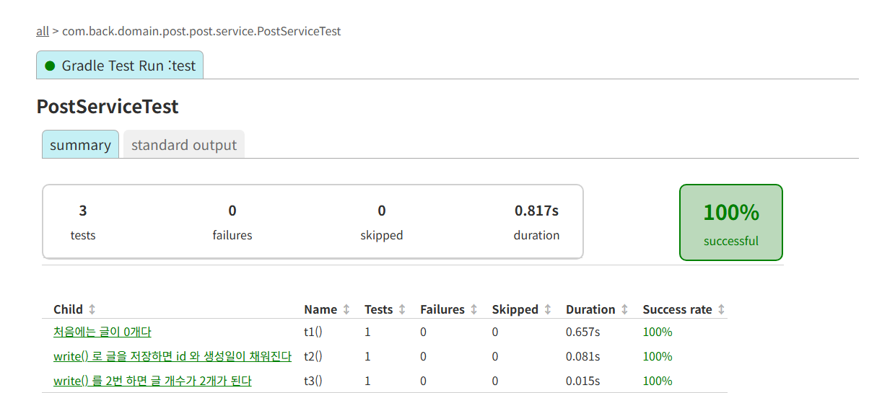

# POSTpractice2

글·댓글 게시판 REST API를 **아주 작은 단계**로 나눠 만들면서, 단계마다 코드 + 테스트 + 결과 캡처를 커밋하는 실습입니다.

- 참고: [slog.gg/p/14172](https://www.slog.gg/p/14172/raw)
- 기술: Java 25, Spring Boot 4.1.2, Spring Data JPA, H2, Lombok, JUnit 5 + MockMvc
- 테스트 실행: `./gradlew test` (리포트: `build/reports/tests/test/index.html`)

## 진행 상황

| 단계 | 내용 | 상태 |
|---|---|---|
| 1-1 | 빈 Spring Boot 프로젝트 + 앱 실행 테스트 | ✅ 완료 |
| 1-2 | JPA·H2 설정 + `BaseEntity` + `Post` 엔티티 | ✅ 완료 |
| 1-3 | `PostRepository` + `PostService` + 테스트 | ✅ 완료 |
| 1-4 | 샘플 글 3건 자동 생성 + 테스트 | ⏳ 예정 |
| 1-5 | `PostComment` 엔티티 + `post.addComment()` | ⏳ 예정 |
| 1-6 | 샘플 댓글 5건 자동 생성 + 테스트 | ⏳ 예정 |
| 2-1 ~ 2-3 | 글 작성 API → 성공 테스트 → 입력값 검증·실패 테스트 | ⏳ 예정 |
| 3-1 ~ 3-3 | 글 삭제 API → 성공 테스트 → 없는 글 삭제·실패 테스트 | ⏳ 예정 |
| 4-1 ~ 4-3 | 댓글 작성 API → 성공 테스트 → 입력값 검증·실패 테스트 | ⏳ 예정 |
| 5-1 ~ 5-3 | 댓글 삭제 API → 성공 테스트 → 없는 댓글 삭제·실패 테스트 | ⏳ 예정 |

## 만들 API

| 메서드 | URL | 기능 | 단계 |
|---|---|---|---|
| POST | `/api/v1/posts` | 글 작성 | 2단계 |
| DELETE | `/api/v1/posts/{id}` | 글 삭제 | 3단계 |
| POST | `/api/v1/posts/{postId}/comments` | 댓글 작성 | 4단계 |
| DELETE | `/api/v1/posts/{postId}/comments/{id}` | 댓글 삭제 | 5단계 |

---

## 1-1: 빈 Spring Boot 프로젝트 + 앱 실행 테스트

### 추가된 파일

| 파일 | 역할 |
|---|---|
| `build.gradle.kts` | 사용할 라이브러리 목록. 지금은 웹(`webmvc`), Lombok, DevTools, 테스트용 라이브러리만 |
| `settings.gradle.kts` | 프로젝트 이름 `POSTpractice2` |
| `gradlew`, `gradle/wrapper/` | Gradle을 따로 설치하지 않아도 빌드할 수 있게 해 주는 래퍼 |
| `src/main/resources/application.yaml` | 앱 설정. 지금은 앱 이름만 |
| `src/main/java/com/back/BackApplication.java` | 앱의 시작점(`main` 메서드) |
| `src/test/java/com/back/BackApplicationTests.java` | 앱이 에러 없이 뜨는지 확인하는 테스트 |

### 핵심 포인트
- `@SpringBootApplication` 이 붙은 클래스의 패키지(`com.back`) **아래에** 있는 클래스만 스프링이 찾아낸다. 그래서 앞으로 만들 모든 클래스는 `com.back.…` 안에 둔다.
- `@SpringBootTest` 는 테스트할 때 스프링을 실제 실행처럼 통째로 띄운다. 테스트 메서드가 비어 있어도, 띄우는 도중에 에러가 나면 실패한다.

### 테스트 결과

| 테스트 | 검증 내용 | 결과 |
|---|---|---|
| `contextLoads` | 앱(스프링)이 에러 없이 실행된다 | ✅ 통과 |


---

## 1-2: JPA·H2 설정 + `BaseEntity` + `Post` 엔티티

### 바뀐 것

| 구분 | 파일 | 내용 |
|---|---|---|
| 수정 | `build.gradle.kts` | `data-jpa`, `h2console`, `h2` 라이브러리 3줄 추가 |
| 수정 | `application.yaml` | DB 연결(`./db_dev` 파일), SQL 로그 출력, 테이블 자동 생성 설정 |
| 수정 | `BackApplication.java` | `@EnableJpaAuditing` 1줄 추가 (날짜 자동 입력 켜기) |
| 추가 | `global/jpa/entity/BaseEntity.java` | 모든 엔티티 공통 칸: `id`, `createDate`, `modifyDate` |
| 추가 | `domain/post/post/entity/Post.java` | 글 엔티티: `title`, `content` |
| 추가 | `test/.../entity/PostTest.java` | `Post` 객체 생성 테스트 |

### 핵심 포인트
- **엔티티 = DB 테이블.** `@Entity` 가 붙은 `Post` 클래스를 보고, 앱이 켜질 때 JPA가 `post` 테이블을 자동으로 만든다(`ddl-auto: update`).
- **`BaseEntity` 를 상속**하므로 `Post` 에 직접 쓰지 않은 `id`, `create_date`, `modify_date` 칼럼도 생긴다.
- **`id` 는 DB가 정한다.** `new Post(...)` 로 만든 직후에는 `id` 가 `null` 이고, DB에 저장(INSERT)될 때 1, 2, 3 ... 이 매겨진다.

### 기록: 앱이 켜질 때 실행된 SQL (테스트 로그에서 발췌)

```sql
create table post (
    id bigint generated by default as identity,
    create_date timestamp(6),
    modify_date timestamp(6),
    content TEXT,
    title varchar(255),
    primary key (id)
)
```

### 테스트 결과

| 테스트 | 검증 내용 | 결과 |
|---|---|---|
| `BackApplicationTests.contextLoads` | JPA·H2 를 붙인 뒤에도 앱이 에러 없이 실행된다 | ✅ 통과 |
| `PostTest.t1` | `new Post("제목", "내용")` 으로 만들면 제목과 내용이 들어간다 | ✅ 통과 |
| `PostTest.t2` | DB에 저장하기 전에는 `id`, `createDate` 가 `null` 이다 | ✅ 통과 |


---

## 1-3: `PostRepository` + `PostService` + 테스트

### 바뀐 것

| 구분 | 파일 | 내용 |
|---|---|---|
| 추가 | `domain/post/post/repository/PostRepository.java` | DB 접근 담당. `JpaRepository` 상속만으로 `save`, `count` 등 사용 |
| 추가 | `domain/post/post/service/PostService.java` | `write(제목, 내용)`, `count()` |
| 추가 | `test/resources/application-test.yaml` | 테스트 전용 설정: 메모리 DB(`db_test`), `create-drop` |
| 수정 | `BackApplicationTests.java` | `@ActiveProfiles("test")` 1줄 추가 |
| 추가 | `test/.../service/PostServiceTest.java` | 글 저장·개수 테스트 |

### 핵심 포인트
- **역할 분리**: Controller(2단계) → **Service**(기능 단위 로직) → **Repository**(DB 접근)
- **의존성 주입**: `PostService` 는 `PostRepository` 를 직접 `new` 하지 않는다. `@RequiredArgsConstructor` 가 만든 생성자로 스프링이 넣어 준다.
- **테스트 DB 분리**: `@ActiveProfiles("test")` 가 붙은 테스트는 메모리 DB를 쓴다. 개발용 `db_dev` 파일은 그대로다.
- **`@Transactional` 테스트**: 테스트가 끝나면 저장한 글이 롤백된다. 그래서 `t3` 에서 2개를 저장해도 다른 테스트의 `count()` 에 영향이 없다.

### 기록: `write()`, `count()` 가 실행한 SQL (테스트 로그에서 발췌)

```sql
-- postService.write("제목", "내용") → postRepository.save(post)
insert into post (content, create_date, modify_date, title, id)
values (?, ?, ?, ?, default)

-- postService.count() → postRepository.count()
select count(*) from post p1_0
```

### 테스트 결과

| 테스트 | 검증 내용 | 결과 |
|---|---|---|
| `PostServiceTest.t1` | 처음에는 글이 0개다 | ✅ 통과 |
| `PostServiceTest.t2` | `write()` 로 저장하면 `id`, `createDate` 가 채워진다 (1-2 의 `PostTest.t2` 와 비교) | ✅ 통과 |
| `PostServiceTest.t3` | `write()` 를 2번 하면 `count()` 가 2 | ✅ 통과 |
| 기존 테스트 3건 | `contextLoads`, `PostTest.t1`, `PostTest.t2` | ✅ 통과 |


